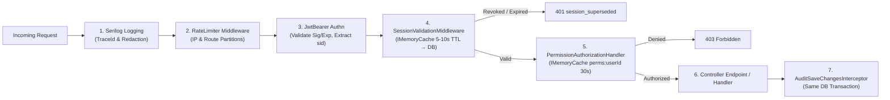
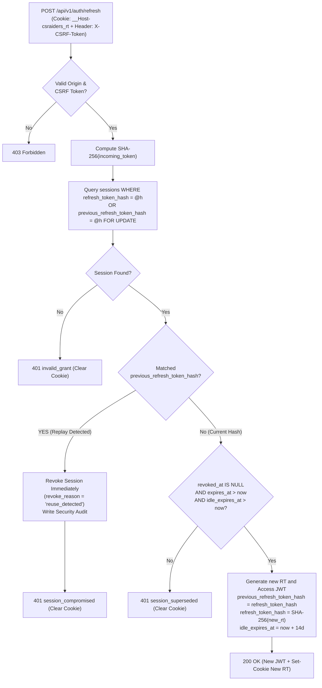

# CS Raiders — Authentication & Session Management

* **Author:** ahmniab
* **Status:** Draft
* **Date:** 2026-11-07

--------------------------------------------------------------------------------

## Overview

This document specifies the authentication, session management, and fine-grained role-based access control (RBAC) subsystem for the CS Raiders ASP.NET Core backend. The subsystem provides user registration, credential verification, token lifecycle management, concurrent session enforcement, and permission evaluation. Operating under the constraint of zero external cache dependencies (no Redis) for Milestone 0, PostgreSQL 16 serves as the authoritative datastore for session truth, lockout state, and replay detection, cushioned by an in-process sliding cache (`IMemoryCache`, 5–10s TTL) in `SessionValidationMiddleware` to eliminate database query amplification on the request hot path.

--------------------------------------------------------------------------------

## The Problem

Educational and testing platforms like CS Raiders require strict account security and session hygiene to safeguard assessment integrity, prevent credential stuffing, and eliminate unauthorized credential sharing. Standard out-of-the-box identity frameworks often introduce operational friction, excessive third-party dependencies, or inflexible session concurrency models.

Specifically, the platform must solve four distinct challenges:
1. **Account Sharing Prevention:** Student accounts must be constrained to a single active session at any given time. If a student logs in from a second device, the prior session must be superseded immediately without leaving dangling active tokens. Conversely, administrative and instructor accounts require managed multi-session capabilities (`session:multi`) with capped concurrency.
2. **Mitigation of Credential & Token Attacks:** The backend must defend against automated credential stuffing, timing-based user enumeration, brute-force attacks on one-time passwords (OTPs), and stolen refresh token replay.
3. **Database Saturation vs. Revocation Immediacy:** Querying PostgreSQL synchronously on every authenticated HTTP request creates severe connection pool saturation and latency spikes under concurrent traffic. Conversely, relying purely on 15-minute stateless JWTs leaves an unacceptable 15-minute window during which superseded student devices or revoked accounts continue accessing protected endpoints. The system must reconcile this tension without operating an external Redis cluster for Milestone 0.
4. **Fine-Grained RBAC with Explicit Overrides:** Course access and administrative operations require permission-based authorization (`[HasPermission]`) rather than static roles. The system must support role bundles with user-level `GRANT` and `DENY` overrides, where explicit `DENY` overrides take precedence.

--------------------------------------------------------------------------------

## Goals

* **Cryptographic Defense:** Store passwords using Argon2id ($m=19456\text{ KiB}, t=2, p=1$) combined with a high-entropy server-side pepper secret (`Auth:PasswordPepper`). Constrain concurrent password hashing via bounded semaphores to protect CPU capacity.
* **Anti-Enumeration Protection:** Return uniform HTTP status codes (`202 Accepted` for registration/password reset, `401 Unauthorized` for login) and execute timing-safe dummy Argon2id verifications when submitted email addresses do not exist.
* **OTP-Based Registration:** Protect new user registrations using 6-digit numeric CSPRNG codes bound to the email address and stored as HMAC-SHA256 hashes, strictly limited to 5 attempts and a 10-minute expiration window.
* **Durable Brute-Force & Lockout Protection:** Implement a two-tier brute-force mitigation strategy combining in-memory rate limiting with a durable PostgreSQL `login_attempts` table enforcing progressive delays (attempts 4–9) and a 15-minute account lockout (attempt 10).
* **Controlled Session Concurrency:** Enforce single active session concurrency per user by default (`enforce_single_session = true`), immediately superseding prior sessions upon new login, while allowing multi-session access up to a configurable cap for identities with `session:multi`.
* **Rotating Refresh Tokens with Replay Detection:** Issue 15-minute stateless JWT access tokens alongside 30-day rotating refresh tokens delivered in secure HTTP-only cookies (`__Host-csraiders_rt`), protected by double-submit CSRF headers and instant session revocation upon token replay detection.
* **Hot-Path Throughput Protection:** Validate active sessions in `SessionValidationMiddleware` backed by an in-process sliding cache (`IMemoryCache`, 5–10s TTL). Cache hits bypass database I/O entirely; cache misses query PostgreSQL by indexed `id` and populate the cache, reducing database query volume by over 95% while bounding revocation delay to at most 10 seconds.
* **Effective Permission Evaluation:** Resolve effective permissions dynamically via $( \text{Roles} \cup \text{Grants} ) \setminus \text{Denies}$, cached in memory with a 30-second TTL and evicted immediately upon RBAC mutations.

--------------------------------------------------------------------------------

## Non-Goals

* **External Distributed Caching:** Deploying or managing external caching infrastructure (Redis, KeyDB, Memcached) is excluded for Milestone 0. PostgreSQL remains the sole authoritative persistence store.
* **Third-Party Identity Providers:** OAuth2/OIDC social logins (e.g., Google, GitHub) are excluded from the initial release.
* **Passwordless Authentication:** WebAuthn, FIDO2, and passkey authentication flows are deferred to future milestones.
* **Permission Claims in Access Tokens:** Roles and permission lists will not be encoded inside JWT claim payloads to avoid stale authorization windows and token payload bloat.

--------------------------------------------------------------------------------

## Open Questions

* **Reverse Proxy Trust Configuration:** What header forwarding strategy (`X-Forwarded-For` and `ForwardedHeadersOptions`) will the ingress gateway / reverse proxy enforce to guarantee trusted client IP resolution for rate limiting?
* **Local Developer Certificate Setup:** Confirm local developer SSL tooling (`dotnet dev-certs https`) to ensure `__Host-` cookies function identically between local development and production.

--------------------------------------------------------------------------------

## Critical User Journeys (CUJs)

### CUJ 1: Student Account Registration & Verification
* **Given**: A prospective student with a valid email address not yet registered in `users`.
* **When**: The user submits registration details (name, email, password) to `POST /api/v1/auth/register`.
* **Then**: The password is encrypted with Argon2id and stored in `pending_registrations` alongside an HMAC-SHA256 OTP hash; a 6-digit verification code is emailed; upon entering the code at `POST /api/v1/auth/verify-otp`, the user is activated in `users` with the default `Student` role preset and pending credentials are purged.

### CUJ 2: Student Login & Single-Session Supersession
* **Given**: A student has an active session on Device A.
* **When**: The student logs in from Device B using valid credentials.
* **Then**: The database updates the Device A session to `revoked_at = NOW()` and `revoke_reason = 'superseded'`, creates an active session for Device B, sets the `__Host-csraiders_rt` cookie, and returns a 15-minute access JWT; subsequent requests from Device A fail with `401 session_superseded` within 5–10 seconds (upon local cache expiration).

### CUJ 3: Refresh Token Rotation & Theft Detection
* **Given**: A client possesses a valid refresh token cookie ($RT_1$).
* **When**: An attacker intercepts $RT_1$ and exchanges it for a new token pair ($RT_2$), after which the legitimate client attempts to refresh using $RT_1$.
* **Then**: The server detects that $RT_1$ matches `previous_refresh_token_hash`, immediately revokes the session row with `revoke_reason = 'reuse_detected'`, emits a security audit event, clears the cookie, and rejects both the legitimate client and the attacker with `401 session_compromised`.

### CUJ 4: Role Modification & Live Session Reconciliation
* **Given**: A user holds a role with `session:multi` and has 3 active sessions across different devices.
* **When**: An administrator updates the user's role or adds an explicit `DENY` override for `session:multi`.
* **Then**: In the same database transaction, the system revokes the two older sessions with `revoke_reason = 'policy_reduced'`, updates the newest surviving session to `enforce_single_session = true`, evicts the permission cache, and updates session state.

--------------------------------------------------------------------------------

## Technical Plan (Architecture)

### 1. Request Pipeline Architecture

The ASP.NET Core middleware pipeline executes defensive controls in a strict, deterministic sequence:



#### Middleware Specifications:
1. **Rate Limiting Middleware:** Implements IP-based (`20 req / 1 min`) and normalized email partitions (`10 req / 1 min`) on `/api/v1/auth/*` routes to stop volumetric attacks prior to cryptographic execution.
2. **JwtBearer Authentication:** Cryptographically validates access token signature, expiration (`exp`), issuer, and audience. Extracts `sid` (Session ID) and `sub` (User ID) claims.
3. **SessionValidationMiddleware:** 
   * Reads the `sid` claim from the authenticated principal.
   * Checks local `IMemoryCache` under `session:status:{sid}`.
   * If found and active: request proceeds immediately without database query.
   * If missing or expired: executes indexed database query (`SELECT revoked_at, expires_at, idle_expires_at FROM sessions WHERE id = @sid`).
   * If revoked or expired: removes cache entry, clears cookies, and short-circuits with `401 session_superseded`.
   * If active: stores active status in `IMemoryCache` with a 5–10 second sliding expiration.
   * Throttles `last_seen_at` updates to PostgreSQL to at most once per 60 seconds per session.
4. **PermissionAuthorizationHandler (`[HasPermission]`):** Evaluates whether the user holds the required granular permission by checking `IMemoryCache` (`perms:{userId}`, 30s TTL). Resolves effective permissions on cache miss.

---

### 2. Cryptographic Architecture & Secrets

| Component | Target Artifact | Specification | Verification |
| :--- | :--- | :--- | :--- |
| **Password Storage** | `users.password_hash`, `pending_registrations.password_hash` | Argon2id ($m=19456\text{ KiB}, t=2, p=1$, 128-bit salt, 256-bit tag) formatted as standard PHC string. Hashed with secret 256-bit server pepper (`Auth:PasswordPepper`). | `CryptographicOperations.FixedTimeEquals` |
| **Dummy Verification** | Memory-static dummy hash | Static pre-computed dummy Argon2id hash initialized at application startup with identical cost parameters. | Run on user lookup failure to eliminate timing-based email enumeration. |
| **Registration OTP** | `pending_registrations.otp_hash` | 6-digit numeric CSPRNG string hashed via `HMAC-SHA256(key: Auth:OtpHmacKey, data: $"{email}:{otp}")`. | `FixedTimeEquals` + 5 attempt cap + 10m TTL. |
| **Refresh Token** | `sessions.refresh_token_hash`, `sessions.previous_refresh_token_hash` | 32-byte Base64Url CSPRNG string stored as `SHA-256` binary hash. | Indexed lookup + `FixedTimeEquals` + rotation. |
| **Password Reset** | `password_reset_tokens.token_hash` | 32-byte Base64Url CSPRNG string stored as `SHA-256` binary hash. | Single-use lookup + `FixedTimeEquals` + 30m TTL. |

---

### 3. Session Concurrency, Rotation & Replay Theft Mitigation

#### Single-Session & Multi-Session Concurrency
* **Default Single-Session (`enforce_single_session = true`):**
  When a student logs in, an atomic SQL statement supersedes prior active sessions and inserts the new session under the partial unique index:
  ```sql
  CREATE UNIQUE INDEX uq_sessions_one_active
      ON sessions (user_id)
      WHERE revoked_at IS NULL AND enforce_single_session = true;
  ```
  This eliminates multi-step transaction lock holding and prevents deadlocks or hash collisions under concurrent login attempts.
* **Multi-Session (`enforce_single_session = false`):**
  For users holding the `session:multi` permission, active sessions are counted. If active sessions exceed the configured cap (`session.multi_max_concurrent`, default 3), the oldest session is updated to `revoked_at = NOW()`, `revoke_reason = 'cap_exceeded'`.

#### Refresh Token Rotation & Reuse Detection
* At `POST /api/v1/auth/refresh`, the client provides the refresh token cookie (`__Host-csraiders_rt`) and the CSRF header (`X-CSRF-Token`).
* The incoming token's SHA-256 hash is queried against `sessions`:
  * If it matches `previous_refresh_token_hash`, a replay attack is detected: the session is revoked immediately (`revoke_reason = 'reuse_detected'`), an out-of-band audit log is emitted, cookies are cleared, and `401 session_compromised` is returned.
  * If it matches `refresh_token_hash` and the session is active: a new refresh token and access JWT are generated, the old hash moves to `previous_refresh_token_hash`, the new hash is written to `refresh_token_hash`, and updated cookies are emitted.



---

### 4. RBAC Permission Engine & Live Reconciliation

* **Effective Permission Calculation:**
  $$\text{EffectivePermissions}(u) = \left( \bigcup_{r \in \text{Roles}(u)} \text{Permissions}(r) \cup \text{Grants}(u) \right) \setminus \text{Denies}(u)$$
  Implemented via existing domain logic in [`EffectivePermissions.Resolve`](file:///mnt/projects/web/backend/dotnet/CsRaiders.Api/src/CsRaiders.Api.Domain/Policies/EffectivePermissions.cs#L6-L19).
* **Live Session Reconciliation:**
  When an admin modifies a role or adds a user-level permission override that revokes `session:multi`:
  1. Identifies the newest active session for the user (`ORDER BY created_at DESC LIMIT 1`).
  2. Updates older active sessions to `revoked_at = NOW()`, `revoke_reason = 'policy_reduced'`.
  3. Updates the newest session to `enforce_single_session = true`.
  4. Evicts `perms:{userId}` from `IMemoryCache`.
  Executing step 2 before step 3 ensures the partial unique index `uq_sessions_one_active` is never violated.

--------------------------------------------------------------------------------

## Alternatives Considered

### Alternative 1: Distributed Session Cache via Redis / KeyDB
* **Pros**: Native sub-millisecond session lookup latency, zero relational database read load on the request hot path, and straightforward pub/sub cache invalidation across distributed nodes.
* **Cons**: Introduces an external infrastructure dependency requiring provisioning, monitoring, clustering, security hardening, and backup management during Milestone 0.
* **Reason for Rejection**: `Rejected by author: Milestone 0 prioritizes operational simplicity and self-contained deployment. PostgreSQL 16 backed by an in-process sliding cache (5–10s TTL) satisfies throughput and revocation targets without introducing external cluster dependencies.`

### Alternative 2: Pure Stateless JWT Authentication (No Session Validation Middleware)
* **Pros**: Maximum API throughput, zero database roundtrips, and the simplest stateless backend architecture.
* **Cons**: Precludes instant revocation upon password reset, session logout, or administrative account suspension; cannot enforce single-session concurrency for students (Device A remains active for up to 15 minutes after Device B logs in).
* **Reason for Rejection**: `Rejected by author: Academic assessment integrity and account sharing prevention require immediate single-session supersession. A 15-minute exposure window where superseded devices retain full access violates core platform requirements.`

### Alternative 3: Role-Based Authorization (`IsInRole` / `[Authorize(Roles = ...)]`)
* **Pros**: Standard built-in ASP.NET Core pattern with minimal initial configuration.
* **Cons**: Coarse-grained roles lead to role explosion as permissions evolve; cannot express user-specific temporary grants or explicit `DENY` overrides without defining new bespoke roles.
* **Reason for Rejection**: `Rejected by author: System requirements mandate fine-grained permissions ([HasPermission]) with user-level grant/deny overrides to support granular course, grading, and administrative access.`

### Alternative 4: Synchronous Database Query on Every Authenticated Request (Zero Caching)
* **Pros**: Zero staleness propagation delay upon session revocation or supersession.
* **Cons**: Causes severe read query amplification on PostgreSQL; saturates connection pools (Npgsql default max 100) under standard concurrent traffic (500–1,500 RPS) and introduces relational query latency on every API call.
* **Reason for Rejection**: `Rejected by author: Connection pool saturation risk is unacceptable. An in-process 5–10s sliding cache provides >95% query reduction while bounding revocation delay to acceptable operational limits.`

--------------------------------------------------------------------------------

## Non-Functional Requirements

### 1. Security & Privacy
* **Secret Redaction:** Passwords, OTPs, refresh tokens, and authentication cookies are strictly redacted from all Serilog application logs and EF Core database audit trails.
* **Timing-Attack Resistance:** Password verification and unknown user lookups execute in constant time using Argon2id dummy hashes and `CryptographicOperations.FixedTimeEquals`.
* **Transport Security:** Refresh tokens and CSRF cookies mandate HTTPS (`Secure; HttpOnly; SameSite=Lax; Path=/`) with `__Host-` prefix verification in production.

### 2. Performance & Latency
* **Hot-Path Response Times:** Authenticated requests served from `IMemoryCache` must resolve session validity in $< 1\text{ ms}$, maintaining P99 latency $< 20\text{ ms}$ for core API endpoints.
* **Connection Pool Protection:** Database reads for session validation are throttled via in-process caching, and `last_seen_at` database writes are debounced to at most once per 60 seconds per session.
* **CPU Capacity Protection:** Password hashing execution is constrained by a bounded concurrency semaphore matched to available physical CPU cores to prevent thread pool starvation during traffic spikes.

### 3. Rollout & Backward Compatibility
* **Schema Evolution:** Managed via EF Core migrations with explicit raw SQL constraints (`citext`, partial unique index `uq_sessions_one_active`).
* **Session Lifecycle Safety:** Revocation of superseded sessions executes atomically inside database transactions to ensure database consistency across server restarts.

--------------------------------------------------------------------------------

## Detailed Implementation Plan

### Target Files to Create/Modify

#### Application Layer (`CsRaiders.Api.Application`)

1. `src/CsRaiders.Api.Application/Common/Interfaces/Security/IPasswordHasher.cs` ([Create])
   * **Type / Scope**: C# Interface
   * **Proposed Changes**: Defines `string HashPassword(string password)` and `PasswordVerificationResult VerifyPassword(string password, string phcHash)` returning `{ bool IsValid, bool NeedsRehash }`.
   * **Rationale**: Decouples the application layer from concrete Argon2id cryptographic implementations and enables parameter upgrades.

2. `src/CsRaiders.Api.Application/Common/Interfaces/Security/IOtpGenerator.cs` ([Create])
   * **Type / Scope**: C# Interface
   * **Proposed Changes**: Defines `string GenerateOtp()` and `byte[] ComputeOtpHmac(string email, string otp)`.
   * **Rationale**: Encapsulates 6-digit numeric CSPRNG code generation and HMAC-SHA256 email binding.

3. `src/CsRaiders.Api.Application/Common/Interfaces/Security/ITokenService.cs` ([Create])
   * **Type / Scope**: C# Interface
   * **Proposed Changes**: Defines `TokenPair GenerateTokens(User user, Guid sessionId)` and `byte[] ComputeTokenHash(string token)`.
   * **Rationale**: Centralizes creation of 15-minute JWT access tokens and 32-byte rotating refresh tokens.

4. `src/CsRaiders.Api.Application/Common/Interfaces/Security/ISecurityAuditWriter.cs` ([Create])
   * **Type / Scope**: C# Interface
   * **Proposed Changes**: Defines `Task WriteSecurityEventAsync(string eventName, string? email, Guid? userId, string? ipAddress, object? details, CancellationToken ct)`.
   * **Rationale**: Emits out-of-band audit events for failed operations using an independent connection that survives transaction rollback.

5. `src/CsRaiders.Api.Application/Features/Auth/Commands/Register/RegisterCommand.cs` & `RegisterCommandHandler.cs` ([Create])
   * **Type / Scope**: MediatR Command & Handler
   * **Proposed Changes**: Validates inputs with FluentValidation (password 8–128 chars, NFC normalized). Hashes password with Argon2id prior to row creation. Checks existing users; if registered, enqueues notice; if new, writes to `pending_registrations` with 5 attempts, 10m TTL, and returns generic `202 Accepted`.
   * **Rationale**: Implements secure self-registration with timing-safe anti-enumeration (`FR-60`).

6. `src/CsRaiders.Api.Application/Features/Auth/Commands/VerifyOtp/VerifyOtpCommand.cs` & `VerifyOtpCommandHandler.cs` ([Create])
   * **Type / Scope**: MediatR Command & Handler
   * **Proposed Changes**: Loads `PendingRegistration` by email with `FOR UPDATE`. Verifies HMAC OTP via `CryptographicOperations.FixedTimeEquals`. Decrements `attempts_left` on mismatch. On match, creates `User` with `Student` role preset, deletes pending row, and audits event.
   * **Rationale**: Fulfills OTP verification with strict 5-attempt brute-force protection.

7. `src/CsRaiders.Api.Application/Features/Auth/Commands/Login/LoginCommand.cs` & `LoginCommandHandler.cs` ([Create])
   * **Type / Scope**: MediatR Command & Handler
   * **Proposed Changes**: Consults durable `login_attempts` for progressive delay / 15m lockout. If user null, executes dummy Argon2id hash. If password valid, deactivates superseded sessions under atomic single-session constraint (`uq_sessions_one_active`) or enforces `session:multi` cap (max 3), records session, resets attempts, and returns access token + refresh token.
   * **Rationale**: Implements hardened credential verification with two-tier brute-force mitigation and atomic single-session concurrency (`FR-61`, `FR-64`).

8. `src/CsRaiders.Api.Application/Features/Auth/Commands/Refresh/RefreshTokenCommand.cs` & `RefreshTokenCommandHandler.cs` ([Create])
   * **Type / Scope**: MediatR Command & Handler
   * **Proposed Changes**: Computes SHA-256 hash of incoming refresh token. Queries `sessions`. If matching `previous_refresh_token_hash`, revokes session immediately (`revoke_reason = 'reuse_detected'`) and returns `401 session_compromised`. If matching `refresh_token_hash`, rotates token pair and extends idle expiration.
   * **Rationale**: Enforces refresh token rotation and replay theft detection (`FR-63`).

9. `src/CsRaiders.Api.Application/Features/Auth/Commands/Logout/LogoutCommand.cs` & `LogoutCommandHandler.cs` ([Create])
   * **Type / Scope**: MediatR Command & Handler
   * **Proposed Changes**: Revokes current session by `sid` (`revoke_reason = 'logout'`), clears `IMemoryCache` entry, and instructs response to clear cookies.
   * **Rationale**: Ensures immediate server-side and client-side session termination.

10. `src/CsRaiders.Api.Application/Features/Auth/Commands/ForgotPassword/ForgotPasswordCommand.cs` & `ResetPasswordCommand.cs` ([Create])
    * **Type / Scope**: MediatR Commands & Handlers
    * **Proposed Changes**: Forgot password generates 32-byte CSPRNG token in `password_reset_tokens` (30m TTL) with anti-enumeration response. Reset password validates token via constant-time SHA-256 lookup, updates Argon2id password hash, revokes all active sessions for user, and marks token used.
    * **Rationale**: Implements secure self-service password recovery with global session invalidation (`FR-65`).

11. `src/CsRaiders.Api.Application/Features/Sessions/Queries/GetActiveSessionsQuery.cs` & `RevokeSessionCommands.cs` ([Create])
    * **Type / Scope**: MediatR Queries & Handlers
    * **Proposed Changes**: Returns active sessions for the calling user (`last_seen_at`, `ip`, `user_agent`, `created_at`). Allows revoking a specific session or revoking all other sessions.
    * **Rationale**: Empowers users with self-service active session visibility and device management.

12. `src/CsRaiders.Api.Application/Features/Admin/Roles/Commands/UpdateRolePermissionsCommand.cs` ([Create])
    * **Type / Scope**: MediatR Command & Handler
    * **Proposed Changes**: Updates role permission sets. Prevents privilege escalation (`FR-78`). Triggers `SessionReconciliationService` for affected users if `session:multi` changed.
    * **Rationale**: Enforces transactional RBAC administration and live session reconciliation.

#### Infrastructure Layer (`CsRaiders.Api.Infrastructure`)

13. `src/CsRaiders.Api.Infrastructure/Security/Argon2idPasswordHasher.cs` ([Create])
    * **Type / Scope**: C# Service (implements `IPasswordHasher`)
    * **Proposed Changes**: Wraps `Konscious.Security.Cryptography.Argon2id`. Normalizes input to Unicode NFC. Applies 256-bit server pepper (`Auth:PasswordPepper`). Parses and outputs standard PHC format (`$argon2id$v=19$m=19456,t=2,p=1$...`). Constrains concurrency using a bounded `SemaphoreSlim` matching core count.
    * **Rationale**: Provides NIST/OWASP-compliant password hashing and memory-hardness protection.

14. `src/CsRaiders.Api.Infrastructure/Security/HmacOtpGenerator.cs` ([Create])
    * **Type / Scope**: C# Service (implements `IOtpGenerator`)
    * **Proposed Changes**: Generates cryptographically secure 6-digit integer string (`RandomNumberGenerator.GetInt32(0, 1_000_000)`). Computes `HMACSHA256` keyed by `Auth:OtpHmacKey`.
    * **Rationale**: Implements CSPRNG OTP generation with tamper-proof email binding.

15. `src/CsRaiders.Api.Infrastructure/Security/TokenService.cs` ([Create])
    * **Type / Scope**: C# Service (implements `ITokenService`)
    * **Proposed Changes**: Mints 15-minute asymmetric or HMAC signed JWTs containing `sub`, `sid`, `iat`, `exp`. Mints 32-byte Base64Url refresh tokens. Generates SHA-256 hashes for database persistence.
    * **Rationale**: Provides centralized token generation with strict claim discipline.

16. `src/CsRaiders.Api.Infrastructure/Services/LoginAttemptTracker.cs` ([Create])
    * **Type / Scope**: C# Service
    * **Proposed Changes**: Interacts with `login_attempts` table. Increments failures on bad attempts, calculates exponential backoff delay ($2^{\text{fails}-3}$ seconds, capped at 15s) after attempt 3, and sets 15-minute lockout at attempt 10.
    * **Rationale**: Provides persistent brute-force defense that survives container restarts.

17. `src/CsRaiders.Api.Infrastructure/Services/SessionReconciliationService.cs` ([Create])
    * **Type / Scope**: C# Service
    * **Proposed Changes**: Executes transactional session reconciliation when `session:multi` is revoked from a user: revokes older active sessions with `policy_reduced` before setting `enforce_single_session = true` on the surviving newest session.
    * **Rationale**: Guarantees zero `23505` unique constraint violations and immediate policy enforcement.

18. `src/CsRaiders.Api.Infrastructure/Logging/SecurityAuditWriter.cs` ([Create])
    * **Type / Scope**: C# Service (implements `ISecurityAuditWriter`)
    * **Proposed Changes**: Writes security failure events directly to database using short-lived isolated transaction scope (`TransactionScopeOption.Suppress`).
    * **Rationale**: Ensures critical security events (lockouts, OTP failures, token reuse) are persisted even when the triggering request transaction fails.

19. `src/CsRaiders.Api.Infrastructure/Interceptors/AuditSaveChangesInterceptor.cs` ([Modify])
    * **Type / Scope**: EF Core `SaveChangesInterceptor`
    * **Proposed Changes**: Enforces secret redaction on audit JSON serialization (`password`, `otp`, `refreshToken`, `token_hash`).
    * **Rationale**: Prevents accidental leakage of credential material into audit tables.

#### API Layer (`CsRaiders.Api.API`)

20. `src/CsRaiders.Api.API/Middleware/SessionValidationMiddleware.cs` ([Create])
    * **Type / Scope**: ASP.NET Core Middleware
    * **Proposed Changes**: Reads `sid` from authenticated claims. Looks up `session:status:{sid}` in `IMemoryCache`. If missing, queries PostgreSQL `sessions` row by `id`. Rejects invalid/revoked sessions with `401 session_superseded`. Caches active status for 5–10s sliding window. Debounces `last_seen_at` updates to once per minute.
    * **Rationale**: Enforces instant session validity while eliminating 95%+ of database queries.

21. `src/CsRaiders.Api.API/Authorization/HasPermissionAttribute.cs` & `PermissionAuthorizationHandler.cs` ([Create])
    * **Type / Scope**: Authorization Attribute & `AuthorizationHandler<PermissionRequirement>`
    * **Proposed Changes**: Extracts `userId`, checks `IMemoryCache` for `perms:{userId}` (30s TTL). Resolves effective permissions via domain policy on miss. Authorizes or returns `403 Forbidden`.
    * **Rationale**: Implements fine-grained RBAC authorization without role-name checks.

22. `src/CsRaiders.Api.API/Filters/CsrfValidationFilter.cs` ([Create])
    * **Type / Scope**: ASP.NET Core Action Filter
    * **Proposed Changes**: Validates `Origin`/`Referer` header against configured allowed origins and verifies that `X-CSRF-Token` header matches `__Host-csraiders_csrf` cookie on cookie-authenticated POST endpoints (`/auth/refresh`, `/auth/logout`).
    * **Rationale**: Prevents cross-site request forgery attacks on refresh token exchange.

23. `src/CsRaiders.Api.API/Controllers/AuthController.cs` ([Create])
    * **Type / Scope**: API Controller (`/api/v1/auth`)
    * **Proposed Changes**: Exposes `register`, `verify-otp`, `login`, `refresh`, `logout`, `forgot-password`, `reset-password`. Sets and clears `__Host-csraiders_rt` and `__Host-csraiders_csrf` cookies.
    * **Rationale**: Provides the public authentication HTTP interface.

24. `src/CsRaiders.Api.API/Controllers/MeSessionsController.cs` ([Create])
    * **Type / Scope**: API Controller (`/api/v1/me/sessions`)
    * **Proposed Changes**: Decorated with `[Authorize(Policy = AuthPolicies.AuthenticatedOnly)]`. Exposes listing active sessions and revoking specific/all other sessions.
    * **Rationale**: Provides self-service session management.

25. `src/CsRaiders.Api.API/Controllers/AdminRolesController.cs` & `AdminUsersController.cs` ([Create])
    * **Type / Scope**: API Controllers (`/api/v1/admin/*`)
    * **Proposed Changes**: Decorated with `[HasPermission("role:manage")]` and `[HasPermission("user:manage")]`. Manages roles, permission grants, and user overrides.
    * **Rationale**: Provides administrative RBAC management with privilege escalation guards.

26. `src/CsRaiders.Api.API/Program.cs` ([Modify])
    * **Type / Scope**: Application Bootstrap
    * **Proposed Changes**: Registers authentication/authorization services, rate limiters, session middleware, cookie policies, and verifies minimum entropy for `Auth:PasswordPepper` at startup.
    * **Rationale**: Boots the fully configured security pipeline.

---

## Verification Plan

### Automated Tests

#### 1. Unit Tests (`CsRaiders.Api.Domain.UnitTests` & `CsRaiders.Api.Application.UnitTests`)
* Run Command: `dotnet test tests/CsRaiders.Api.Domain.UnitTests --no-restore`
* **Test Cases:**
  * `EffectivePermissionsTests`: Verify role union, user grant addition, and user `DENY` precedence.
  * `SessionPolicyTests`: Verify single-session decision and multi-session cap enforcement.
  * `Argon2idPasswordHasherTests`: Verify PHC format generation, salt randomness, pepper integration, and constant-time mismatch rejection.
  * `HmacOtpGeneratorTests`: Verify OTP code format (6 digits) and HMAC verification.
  * `FluentValidationTests`: Assert passwords $< 8$ or $> 128$ characters are rejected before hashing.

#### 2. Security & Integration Tests (`CsRaiders.Api.IntegrationTests` via Testcontainers)
* Run Command: `dotnet test tests/CsRaiders.Api.IntegrationTests --no-restore`
* **Test Cases:**
  * **SEC-01 (Password Storage):** Inspect database rows; assert no plaintext password exists and hash begins with `$argon2id$v=19$`.
  * **SEC-02 (Anti-Enumeration):** Assert identical HTTP 202 response and execution of dummy Argon2id hash when registering or logging in with unknown emails.
  * **SEC-03 (OTP Brute Force):** Submit 5 invalid OTPs; assert 6th valid OTP is rejected with `400 invalid_or_expired_otp`.
  * **SEC-04 (Durable Lockout):** Trigger 10 failed logins; restart `WebApplicationFactory` host; assert account remains locked with HTTP 423.
  * **SEC-05 (Single-Session Concurrency):** Fire 10 concurrent logins for the same user via `Task.WhenAll`; assert exactly 1 active session survives without unhandled constraint errors.
  * **SEC-06 (Multi-Session Cap):** Grant `session:multi` (cap = 3); log in 4 times sequentially; assert oldest session is revoked with `cap_exceeded`.
  * **SEC-07 (Live Reconciliation):** User with 3 active sessions has `session:multi` revoked; assert 2 older sessions are revoked (`policy_reduced`) and surviving session is constrained to single session.
  * **SEC-08 (Refresh Token Reuse Detection):** Replay previously rotated refresh token; assert session is immediately revoked (`reuse_detected`) and HTTP 401 is returned.
  * **SEC-09 (Session Cache Verification):** Assert repeated authenticated requests within 5s window do not query PostgreSQL `sessions` table.

#### 3. Architecture Tests (`CsRaiders.Api.ArchitectureTests`)
* Run Command: `dotnet test tests/CsRaiders.Api.ArchitectureTests --no-restore`
* **Assertions:**
  * Zero usages of `User.IsInRole()` or `[Authorize(Roles = ...)]` across the entire solution.
  * Every API controller endpoint is explicitly decorated with `[AllowAnonymous]`, `[Authorize]`, or `[HasPermission]`.
  * `SessionValidationMiddleware` does not inject scoped `AppDbContext` directly inside the hot-path cache hit branch.

--------------------------------------------------------------------------------

*Drafted with EGM*


