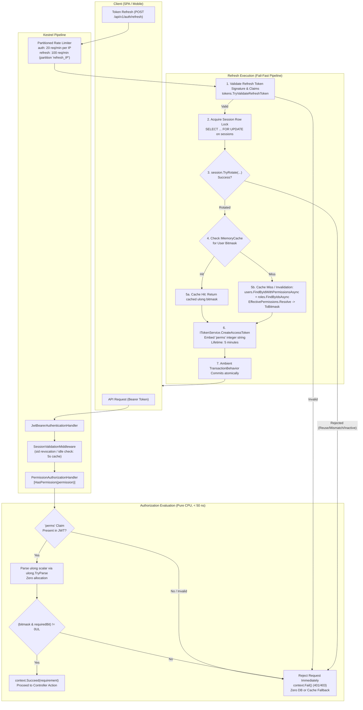

# Token-Embedded Authorization Bitmask Claims

*   **Author:** ahmniab
*   **Status:** Reviewed
*   **Date:** 2026-11-12

--------------------------------------------------------------------------------

## Overview

This feature optimizes endpoint authorization checks across `CsRaiders.Api` by embedding user effective permissions directly into JWT access token claims as a compact 64-bit unsigned integer bitmask (`perms`), serialized as a decimal integer string.

Instead of executing database split queries or in-memory cache lookups on every incoming request decorated with `[HasPermission]`, `PermissionAuthorizationHandler` evaluates permissions locally in memory in sub-microseconds (< 50 ns) via bitwise operations (`(bitmask & requiredPermissionBit) != 0UL`). Access token lifetime is bounded to 5 minutes to ensure administrative role modifications and permission revocations propagate automatically within 5 minutes without disrupting long-lived user sessions.

Because the application is pre-production, legacy token dual-read fallback is eliminated: any incoming access token lacking the `perms` claim is immediately rejected without touching PostgreSQL or `IMemoryCache`. 

Furthermore, permissions remain stored as strings in PostgreSQL (`roles.permissions text[]` and the `user_permissions` table), completely avoiding database schema migrations, preventing bit-shift drift corruption, and preserving granular audit tracking. To protect the database from write contention and query storms during 5-minute token rotations, `RefreshTokenCommandHandler` enforces a fail-fast session rotation sequence and leverages an in-memory bitmask cache, shielding PostgreSQL from multi-table joins on 99%+ of refresh operations.

--------------------------------------------------------------------------------

## The Problem

1. **Authorization Cache & Query Overhead on Protected Endpoints**: In `PermissionAuthorizationHandler.cs`, every request decorated with `[HasPermission]` constructs a cache key (`perms:{userId}`) and queries `IMemoryCache`. On cache misses or invalidations, it executes split queries across `users`, `user_roles`, and `user_permissions` in PostgreSQL. Under high request concurrency, repeated cache key formatting, lock synchronization, and cache lookups add unnecessary latency to high-frequency endpoints.
2. **String-Based Token Bloat**: `PermissionCatalog.cs` defines 20 granular permissions. Serializing these permission strings directly into JWT claims inflates the `Authorization: Bearer` header to 1.5+ KB, consuming network bandwidth and risking HTTP `431 Request Header Fields Too Large` rejections from reverse proxies and edge gateways (Cloudflare, AWS ALB, Nginx).
3. **Workload Inversion & Database Contention on Refresh**: Reducing access token lifetime to 5 minutes triples the frequency of client calls to `POST /api/v1/auth/refresh`. If token refresh unconditionally executes multi-table joins across `users`, `user_roles`, `user_permissions`, and `roles` on every rotation, 10,000 active users would generate ~67 database queries per second, causing database connection pool starvation and lock contention on the `sessions` table.
4. **Refresh DoS Amplification**: In `RefreshTokenCommandHandler.cs`, querying user permissions before verifying the cryptographic presentation, expiration, or rotation validity of the refresh token creates an unauthenticated DoS amplification vector against PostgreSQL.
5. **NAT Rate Limiting Risk**: `CsRaidersApiServiceExtensions.cs` applies a fixed-window rate limiter of 20 requests per minute per IP address across all `/api/v1/auth` routes. With 5-minute access tokens, multiple users sharing a corporate, campus, or cellular NAT gateway will exceed 20 refresh requests per minute, triggering cascading HTTP 429 lockouts.
6. **Client-Side Float Precision Truncation**: When emitting a 64-bit bitmask as an unquoted JSON numeric scalar, standard JavaScript JSON parsers (`JSON.parse()`) decode numbers into 64-bit IEEE-754 floating-point values, silently truncating and corrupting bits beyond $2^{53} - 1$ (`Number.MAX_SAFE_INTEGER`).

--------------------------------------------------------------------------------

## Goals

* **Eliminate In-Memory & Database Lookups on Endpoints**: Evaluate `[HasPermission]` authorization locally in `PermissionAuthorizationHandler` via in-memory bitwise operations without accessing `IMemoryCache` or PostgreSQL.
* **Fail-Fast Non-Fallback Authorization**: Reject any access token lacking the `"perms"` claim immediately, stripping all caching and database repository dependencies from `PermissionAuthorizationHandler`.
* **Zero Database Schema Migrations**: Retain existing string-based permission persistence in PostgreSQL (`roles.permissions text[]` and `user_permissions` table) to eliminate schema migration friction, prevent bit-shift drift corruption, and preserve granular audit records (`granted_by`, `granted_at`).
* **Preserve Safe JavaScript Number Precision**: Encode the 64-bit unsigned bitmask as a decimal integer string (`"perms": "1048575"`) in the JWT payload, preventing 53-bit IEEE-754 floating-point truncation in web clients while maintaining zero-allocation parsing in .NET.
* **Bounded Permission Propagation Window with Instant Sensitive De-escalation**: Bound standard permission de-escalation lag to 5 minutes (+ 30 seconds clock skew tolerance), while requiring critical administrative revocations to invoke `ISessionRepository.RevokeAllByUserIdAsync` for 5-second termination via `SessionValidationMiddleware.cs`.
* **Protect Database Connection Pool**: Enforce strict fail-fast session rotation prior to permission queries in `RefreshTokenCommandHandler`, and cache resolved user bitmasks in memory to keep database load under 1% of refresh traffic.
* **NAT Resilience**: Partition rate limiting on `/api/v1/auth/refresh` using a distinct partition key (`$"refresh_{ip}"`) at 100 req/min (or by session credential) to prevent false-positive 429 lockouts on shared NAT networks.

--------------------------------------------------------------------------------

## Non-Goals

* **Zero-Latency (0 ms) Permission De-escalation on Active Access Tokens**: Standard permission changes take up to 5 minutes to propagate to access tokens upon automatic refresh (immediate 5-second revocation is reserved for full session termination via `SessionValidationMiddleware.cs`).
* **Removing Session Validation Middleware**: `SessionValidationMiddleware.cs` will remain active on every request to enforce session revocation, idle timeouts, account suspensions, and single-session concurrency.
* **In-Flight Token Dual-Read Fallback**: No backward-compatibility fallback for legacy tokens lacking `perms`; all tokens without `perms` fail immediately.
* **Arbitrary Permission Expansion Beyond 64 Flags**: The bitmask allocation supports up to 64 permissions using `ulong` (`UInt64`), bounded by 64-bit integer capacity. Dynamic runtime permission creation is out of scope.
* **Database Schema Alteration**: The agent will not alter or migrate PostgreSQL tables (`roles`, `users`, `user_permissions`).

--------------------------------------------------------------------------------

## Open Questions

*(No open architectural questions remain; all fundamental requirements and reviewer findings were resolved.)*

--------------------------------------------------------------------------------

## Critical User Journeys (CUJs)

### CUJ 1: Authenticated API Request with Bitmask Token
* **Given**: A user holds a valid 5-minute access token containing the `"perms"` decimal integer string claim (e.g. `"1048575"`).
* **When**: The user calls an endpoint decorated with `[HasPermission("course:read")]`.
* **Then**: `PermissionAuthorizationHandler` extracts the `"perms"` claim, parses it as `ulong`, computes `(bitmask & CourseReadBit) != 0UL`, and succeeds immediately in sub-microseconds (< 50 ns) without touching `IMemoryCache` or PostgreSQL.

### CUJ 2: Rejection of Access Token Lacking Bitmask Claim
* **Given**: A client presents an access token lacking the `"perms"` claim (or containing a malformed value).
* **When**: The client calls an endpoint decorated with `[HasPermission("course:read")]`.
* **Then**: `PermissionAuthorizationHandler` detects that `"perms"` is missing, fails authorization immediately (`context.Fail()`), and does not fall back to caching or database queries.

### CUJ 3: Concurrency-Safe Decoupled Token Refresh
* **Given**: A user's access token is nearing its 5-minute expiration.
* **When**: The client calls `POST /api/v1/auth/refresh` with its refresh token cookie.
* **Then**:
  1. `RefreshTokenCommandHandler` validates the cryptographic signature and expiration of the token via `tokens.TryValidateRefreshToken`.
  2. It acquires the pessimistic row lock on `sessions` via `sessions.FindByIdForUpdateAsync(claims.SessionId, ct)`.
  3. It verifies session ownership and executes `session.TryRotate(...)`. If rotation fails, it returns failure immediately without querying permissions.
  4. Upon successful rotation (`RefreshOutcome.Rotated`), it checks `IMemoryCache` for the user's bitmask; on cache miss, it resolves effective permissions via `users.FindByIdWithPermissionsAsync`, `roles.FindByIdsAsync`, and `EffectivePermissions.Resolve`, mapping them to a 64-bit unsigned bitmask via `PermissionBitmaskMapper.ToBitmask`.
  5. It issues a new 5-minute access token containing the `"perms"` integer string and returns `RefreshTokenResult.Success`.
  6. The ambient MediatR `TransactionBehavior` commits the database transaction atomically upon completion.

### CUJ 4: Client-Side Permission Verification via Native BigInt
* **Given**: A frontend single-page application holds an access token containing `"perms": "1048575"`.
* **When**: The UI client checks whether the user has permission to view administrative course management controls corresponding to bit index 1 (`CourseWrite`).
* **Then**: The frontend decodes the claim string and evaluates `(BigInt(jwtPayload.perms) & (1n << 1n)) !== 0n` natively in JavaScript without floating-point precision loss and without binary string conversions.

--------------------------------------------------------------------------------

## Technical Plan (Architecture)

### 1. Architectural Overview & Component Boundaries

The architecture decouples runtime endpoint authorization from storage operations while protecting database locks and eliminating unauthenticated query amplification during token refresh:



### 2. Domain Model & Capability Bitmask Mapping

In `CsRaiders.Api.Domain.Constants`, introduce `PermissionBits` as a flags enum backed by `ulong` (unsigned 64-bit integer), assigning explicit, compile-time static powers of two to all 20 permissions defined in `PermissionCatalog.cs`:

```csharp
namespace CsRaiders.Api.Domain.Constants;

[Flags]
public enum PermissionBits : ulong
{
    None             = 0UL,
    CourseRead       = 1UL << 0,
    CourseWrite      = 1UL << 1,
    CoursePurge      = 1UL << 2,
    LessonWrite      = 1UL << 3,
    AssetWrite       = 1UL << 4,
    QuestionWrite    = 1UL << 5,
    QuizWrite        = 1UL << 6,
    UserRead         = 1UL << 7,
    UserWrite        = 1UL << 8,
    RoleManage       = 1UL << 9,
    PaymentRead      = 1UL << 10,
    PaymentVerify    = 1UL << 11,
    PaymentRefund    = 1UL << 12,
    NotificationSend = 1UL << 13,
    AnalyticsRead    = 1UL << 14,
    AuditRead        = 1UL << 15,
    SettingsRead     = 1UL << 16,
    SettingsWrite    = 1UL << 17,
    SessionMulti     = 1UL << 18,
    SessionRevoke    = 1UL << 19
}
```

A static utility `PermissionBitmaskMapper` in `CsRaiders.Api.Domain.Constants` encapsulates bidirectional translation between string permission identifiers and 64-bit unsigned scalars with strict fail-closed edge case semantics:
* `ulong ToBitmask(IEnumerable<string> permissionNames)`: Aggregates an enumerable of permission string names into a single `ulong` bitmask using bitwise OR. Skips null, empty, or unrecognized permission strings.
* `ulong GetBit(string permissionName)`: Looks up the single `ulong` bit corresponding to a specific permission string. Returns `0UL` (`PermissionBits.None`) if null, empty, or unknown.
* `bool HasPermission(ulong bitmask, ulong requiredBit)`: Evaluates `requiredBit != 0UL && (bitmask & requiredBit) != 0UL`.
* `IReadOnlyList<string> ToPermissionNames(ulong bitmask)`: Translates an active bitmask scalar back to an array of recognized human-readable permission strings defined in `PermissionCatalog.All`.

### 3. Token Generation & Claim Contract

1. **`ITokenService` Interface Update**:
   Update `ITokenService.CreateAccessToken` to accept the precomputed 64-bit unsigned bitmask:
   ```csharp
   string CreateAccessToken(Guid userId, Guid sessionId, ulong permissionsBitmask, DateTimeOffset now);
   ```

2. **`TokenService` Implementation**:
   In `CsRaiders.Api.Infrastructure.Security.TokenService`, serialize the bitmask as a decimal integer string:
   ```csharp
   new Claim("perms", permissionsBitmask.ToString(CultureInfo.InvariantCulture))
   ```
   * **Size Overhead**: An integer string for all 20 active permissions (`"1048575"`) consumes 7 ASCII bytes. Total token payload size remains under 280 bytes.
   * **Client Safety**: JavaScript web clients parse this string via native `BigInt(claim)` without float truncation. Unsigned modeling prevents two's complement negative integer representations.

3. **Configurable Token Lifetime**:
   In `AuthRules.cs`, configure access token lifetime to 5 minutes:
   ```csharp
   public static readonly TimeSpan AccessTokenLifetime = TimeSpan.FromMinutes(5);
   ```

### 4. Endpoint Authorization Handler (Pure In-Memory Evaluation)

In `CsRaiders.Api.API.Authorization.PermissionAuthorizationHandler`:

1. **Complete Removal of External Dependencies**:
   Drop `IUserRepository`, `IRoleRepository`, `IMemoryCache`, `IRbacInvalidationToken`, and `IAuthMetricsRecorder` from the constructor. The handler requires zero database or cache infrastructure.

2. **Strict Fail-Fast Evaluation (Synchronous Signature)**:
   ```csharp
   protected override Task HandleRequirementAsync(
       AuthorizationHandlerContext context,
       PermissionRequirement requirement)
   {
       var permsClaim = context.User.FindFirst("perms");
       if (permsClaim == null || !ulong.TryParse(permsClaim.Value, NumberStyles.None, CultureInfo.InvariantCulture, out var bitmask))
       {
           context.Fail();
           return Task.CompletedTask;
       }

       var requiredBit = PermissionBitmaskMapper.GetBit(requirement.Permission);
       if (requiredBit == 0UL)
       {
           context.Fail();
           return Task.CompletedTask;
       }

       if ((bitmask & requiredBit) != 0UL)
       {
           context.Succeed(requirement);
       }
       else
       {
           context.Fail();
       }

       return Task.CompletedTask;
   }
   ```
   * Total evaluation time is sub-microsecond (< 50 nanoseconds) with zero memory allocations.

### 5. Decoupled Token Refresh & Login Pipeline

1. **`RefreshTokenCommandHandler.cs`**:
   * Inject `ISessionRepository sessions`, `ITokenService tokens`, `IPlatformClock clock`, `ISessionCacheHook sessionCache`, `ISecurityEventRepository audit`, `IUserRepository users`, `IRoleRepository roles`, `IMemoryCache cache`, and `IRbacInvalidationToken invalidation`.
   * **Step 1 (Validate Token)**: Validate refresh token signature via `tokens.TryValidateRefreshToken(request.RefreshToken, now, out var claims)`.
   * **Step 2 (Pessimistic Lock)**: Acquire session row lock via `await sessions.FindByIdForUpdateAsync(claims.SessionId, ct)`. If null or `session.UserId != claims.UserId`, fail with `invalid_grant`.
   * **Step 3 (Rotate & Fail Fast)**: Call `session.TryRotate(...)`. If rotation returns `DeviceMismatch`, `ReuseDetected`, or `Inactive`, update audit/session and return failure immediately without querying permissions.
   * **Step 4 (Resolve Permissions with Memoization)**: On `RefreshOutcome.Rotated`:
     ```csharp
     var cacheKey = $"perms_mask:{session.UserId}";
     if (!cache.TryGetValue(cacheKey, out ulong bitmask))
     {
         var user = await users.FindByIdWithPermissionsAsync(session.UserId, ct: ct);
         if (user is null || !user.CanAuthenticate) return RefreshTokenResult.Failure("invalid_grant");
         var assignedRoles = await roles.FindByIdsAsync(user.Roles.Select(r => r.RoleId), ct);
         var effectiveStrings = EffectivePermissions.Resolve(assignedRoles, user.PermissionOverrides);
         bitmask = PermissionBitmaskMapper.ToBitmask(effectiveStrings);
         
         var cacheEntryOptions = new MemoryCacheEntryOptions
         {
             AbsoluteExpirationRelativeToNow = TimeSpan.FromMinutes(10)
         }.AddExpirationToken(new CancellationChangeToken(invalidation.CurrentToken));
         cache.Set(cacheKey, bitmask, cacheEntryOptions);
     }
     ```
   * **Step 5 (Issue Token)**: Issue token via `tokens.CreateAccessToken(session.UserId, session.Id, bitmask, now)`.
   * **Step 6 (Commit)**: Ambient `TransactionBehavior` commits transaction upon handler return.

2. **`LoginCommandHandler.cs`**:
   * Inject `IRoleRepository roles`, `IMemoryCache cache`, and `IRbacInvalidationToken invalidation` alongside existing dependencies.
   * After verifying credentials and creating the session, resolve effective permissions via `users.FindByIdWithPermissionsAsync`, `roles.FindByIdsAsync`, and `EffectivePermissions.Resolve`.
   * Convert to `ulong bitmask`, populate `perms_mask:{userId}` cache, and supply to `tokens.CreateAccessToken`.

### 6. Rate Limiting Partitioning for NAT Networks

In `CsRaidersApiServiceExtensions.cs`:
1. Partition rate limiting in `PartitionedRateLimiter.Create<HttpContext, string>`:
   * If `context.Request.Path.Equals("/api/v1/auth/refresh", StringComparison.OrdinalIgnoreCase)`, return partition key `$"refresh_{ip}"` configured with permit limit 100 requests per minute.
   * For all other routes matching `context.Request.Path.StartsWithSegments("/api/v1/auth")` (e.g. `/login`, `/register`, `/logout`), return partition key `$"auth_{ip}"` configured with permit limit 20 requests per minute.

--------------------------------------------------------------------------------

## Alternatives Considered

### Alternative A: End-to-End Bigint Database Persistence
* **Pros**: Eliminates string resolution in PostgreSQL during token refresh; allows SQL bitwise aggregation via `BIT_OR(permissions)`.
* **Cons**: Requires breaking schema migrations (`ALTER TABLE roles`, `DROP TABLE user_permissions`); permanently freezes bit shifts in database rows (creating catastrophic data corruption if enum flags ever shift); destroys per-permission audit metadata (`granted_by`, `granted_at`).
* **Reason for Rejection**: Storing strings in the database achieves 100% of the endpoint latency and zero-cache benefits while completely avoiding database migration complexity, audit loss, and bit-drift corruption risks.

### Alternative B: Dual-Read Fallback with `IMemoryCache` in Authorization Handler
* **Pros**: Allows in-flight legacy tokens issued prior to deployment to continue functioning during a zero-downtime rolling deployment.
* **Cons**: Retains `IMemoryCache`, database repository queries, and cache invalidation dependencies in `PermissionAuthorizationHandler`; maintains dead code and attack surface in a pre-production application.
* **Reason for Rejection**: The application has no active production traffic or external client deployments. Legacy tokens do not exist; failing fast simplifies the handler into a pure CPU-bound function with zero I/O.

### Alternative C: Raw JSON Numeric Claim vs. Decimal Integer String Claim
* **Pros**: Saves 2 quotation mark bytes in the JWT header payload.
* **Cons**: JavaScript `JSON.parse()` decodes numbers into IEEE-754 double-precision floats, silently truncating integer bits above $2^{53} - 1$ (`Number.MAX_SAFE_INTEGER`).
* **Reason for Rejection**: Serializing the 64-bit unsigned integer as a decimal string (`"perms": "1048575"`) avoids float truncation and enables native JavaScript `BigInt` bitwise operations while costing zero extra memory allocations in .NET.

### Alternative D: Embed Raw Permission Strings in 5-Minute Access Tokens
* **Pros**: Highly readable claim payload; no bitwise mapping layer required.
* **Cons**: Serializing 20 distinct permission strings inflates the `Authorization: Bearer` header to >1.5 KB, wasting bandwidth and triggering reverse proxy rejections (`HTTP 431 Request Header Fields Too Large`).
* **Reason for Rejection**: Serializing raw permission strings causes unmitigated header bloat with zero functional benefit over a compact 64-bit scalar bitmask.

--------------------------------------------------------------------------------

## Non-Functional Requirements

### Security & Privacy
* **Session Lifetime vs. Access Token Lifetime**:
  * User sessions are **not** revoked after 5 minutes; session duration remains governed by refresh token expiration in `AuthRules.cs` (7 days sliding / 30 days absolute).
  * The frontend client automatically calls `POST /api/v1/auth/refresh` silently in the background when the access token reaches its 5-minute expiry.
* **Permission Propagation Window & Sensitive Revocation**:
  * Standard role updates take up to 5 minutes (+ 30 seconds clock skew tolerance) to reflect on active tokens.
  * For critical administrative de-escalation (revoking `role:manage`, `payment:refund`, `user:write`, `session:revoke` or suspending an account), administrative handlers in `RbacCommands.cs` must invoke `ISessionRepository.RevokeAllByUserIdAsync(targetUserId)`, terminating active user sessions within 5 seconds via `SessionValidationMiddleware.cs`.
* **Cryptographic Tamper Resistance**:
  * The `"perms"` claim is cryptographically signed via HMAC-SHA256 (`TokenValidationParameters.IssuerSigningKey`). Any client-side bitmask tampering invalidates the signature.

### Performance & Latency
* **Endpoint Evaluation**: Local bitwise check completes in sub-microseconds (< 50 ns) with zero heap allocations, zero lock contention, and zero I/O.
* **Token Size**: Access tokens remain under 280 bytes, well below standard reverse proxy thresholds (4 KB–8 KB).
* **Refresh Scalability**: With in-memory bitmask caching on refresh, 99%+ of refresh operations execute zero database queries against `users` and `roles`, holding session row locks strictly for hash rotation and update.

### Rollout & Rollback
* **Zero Database Migration**: Because PostgreSQL tables remain unchanged, rolling back or reverting application binaries requires zero database schema downgrades.
* **Pre-Production Deployment**: Development and staging environments immediately adopt bitmask tokens; missing claims trigger 401/403 errors by design.

--------------------------------------------------------------------------------

## Additional Resources

* [`PermissionCatalog.cs`](file:///mnt/projects/web/backend/dotnet/CsRaiders.Api/src/CsRaiders.Api.Domain/Constants/PermissionCatalog.cs): Canonical list of all 20 system permission strings.
* [`AuthRules.cs`](file:///mnt/projects/web/backend/dotnet/CsRaiders.Api/src/CsRaiders.Api.Domain/Constants/AuthRules.cs): Access token lifetimes and session rules.
* [`EffectivePermissions.cs`](file:///mnt/projects/web/backend/dotnet/CsRaiders.Api/src/CsRaiders.Api.Domain/Policies/EffectivePermissions.cs): Domain logic resolving role permissions and user overrides.
* [`PermissionAuthorizationHandler.cs`](file:///mnt/projects/web/backend/dotnet/CsRaiders.Api/src/CsRaiders.Api.API/Authorization/PermissionAuthorizationHandler.cs): Target authorization handler.
* [`RefreshTokenCommand.cs`](file:///mnt/projects/web/backend/dotnet/CsRaiders.Api/src/CsRaiders.Api.Application/Features/Auth/Commands/Refresh/RefreshTokenCommand.cs): Token refresh handler.
* [`RbacCommands.cs`](file:///mnt/projects/web/backend/dotnet/CsRaiders.Api/src/CsRaiders.Api.Application/Features/Admin/RbacCommands.cs): RBAC management commands.

--------------------------------------------------------------------------------

## Future Improvements

* **Catalog Extension Up to 64 Permissions**: With `ulong`, up to 64 granular permissions can be added without altering the token structure, claim contract, or frontend evaluation logic.

--------------------------------------------------------------------------------

## Detailed Implementation Plan

### Target Files to Create/Modify

#### 1. `src/CsRaiders.Api.Domain/Constants/PermissionBits.cs` (Create)
* **Type / Scope**: C# Domain Flags Enum
* **Proposed Changes**: Define `[Flags] public enum PermissionBits : ulong` mapping all 20 permissions from `PermissionCatalog.cs` to explicit powers of two (`1UL << 0` to `1UL << 19`).

#### 2. `src/CsRaiders.Api.Domain/Constants/PermissionBitmaskMapper.cs` (Create)
* **Type / Scope**: C# Domain Static Utility
* **Proposed Changes**: Encapsulate bidirectional translation methods with fail-closed error semantics:
  - `public static ulong ToBitmask(IEnumerable<string> permissionNames)` (skips unrecognized permissions)
  - `public static ulong GetBit(string permissionName)` (returns `0UL` for unknown or null strings)
  - `public static bool HasPermission(ulong bitmask, ulong requiredBit)` (evaluates `requiredBit != 0UL && (bitmask & requiredBit) != 0UL`)
  - `public static IReadOnlyList<string> ToPermissionNames(ulong bitmask)` (returns mapped known catalog names)

#### 3. `src/CsRaiders.Api.Domain/Constants/AuthRules.cs` (Modify)
* **Type / Scope**: C# Domain Constants
* **Proposed Changes**: Update default `AccessTokenLifetime` from 15 minutes to 5 minutes: `public static readonly TimeSpan AccessTokenLifetime = TimeSpan.FromMinutes(5);`. Update `src/CsRaiders.Api.Domain/Constants/README.md` to document `PermissionBits`, `PermissionBitmaskMapper`, and the 5-minute lifetime.

#### 4. `src/CsRaiders.Api.Application/Common/Interfaces/Security/ITokenService.cs` (Modify)
* **Type / Scope**: C# Application Interface
* **Proposed Changes**: Update `CreateAccessToken` method signature to accept `ulong permissionsBitmask`:
  `string CreateAccessToken(Guid userId, Guid sessionId, ulong permissionsBitmask, DateTimeOffset now);`. Update `src/CsRaiders.Api.Application/Common/Interfaces/Security/README.md`.

#### 5. `src/CsRaiders.Api.Application/Features/Auth/Commands/Login/LoginCommand.cs` (Modify)
* **Type / Scope**: C# Application Command Handler
* **Proposed Changes**: Inject `IRoleRepository roles`, `IMemoryCache cache`, and `IRbacInvalidationToken invalidation`. After verifying credentials and creating session, resolve permissions via `users.FindByIdWithPermissionsAsync` and `roles.FindByIdsAsync`, combine via `EffectivePermissions.Resolve`, compute bitmask via `PermissionBitmaskMapper.ToBitmask`, populate `perms_mask:{userId}` cache, and supply scalar to `tokens.CreateAccessToken`. Update `src/CsRaiders.Api.Application/Features/Auth/Commands/Login/README.md`.

#### 6. `src/CsRaiders.Api.Application/Features/Auth/Commands/Refresh/RefreshTokenCommand.cs` (Modify)
* **Type / Scope**: C# Application Command Handler
* **Proposed Changes**: Inject `IUserRepository users`, `IRoleRepository roles`, `IMemoryCache cache`, and `IRbacInvalidationToken invalidation`. Enforce fail-fast execution order:
  1. Validate refresh token via `tokens.TryValidateRefreshToken`.
  2. Acquire pessimistic lock via `sessions.FindByIdForUpdateAsync`.
  3. Rotate session via `session.TryRotate(...)`. On rejection (`DeviceMismatch`, `ReuseDetected`, `Inactive`), return failure immediately with zero repository queries.
  4. On `RefreshOutcome.Rotated`, check `IMemoryCache` for key `perms_mask:{session.UserId}`; on miss, resolve via `users.FindByIdWithPermissionsAsync`, `roles.FindByIdsAsync`, and `EffectivePermissions.Resolve`, convert to `ulong bitmask`, and store in cache with `IRbacInvalidationToken` expiration.
  5. Issue access token via `tokens.CreateAccessToken(session.UserId, session.Id, bitmask, now)`. Update `src/CsRaiders.Api.Application/Features/Auth/Commands/Refresh/README.md`.

#### 7. `src/CsRaiders.Api.Application/Features/Admin/RbacCommands.cs` (Modify)
* **Type / Scope**: C# Application Command Handlers
* **Proposed Changes**: In `UpdateRolePermissionsCommandHandler` and `SetUserPermissionOverrideCommandHandler`, when sensitive permissions (`role:manage`, `payment:refund`, `user:write`, `session:revoke`) are removed, invoke `await sessions.RevokeAllByUserIdAsync(targetUserId, ct)` to force immediate 5-second termination of compromised sessions.

#### 8. `src/CsRaiders.Api.Infrastructure/Security/TokenService.cs` (Modify)
* **Type / Scope**: C# Infrastructure Service
* **Proposed Changes**: Implement updated `CreateAccessToken`, adding claim `new Claim("perms", permissionsBitmask.ToString(CultureInfo.InvariantCulture))` to the token descriptor. Update `src/CsRaiders.Api.Infrastructure/Security/README.md`.

#### 9. `src/CsRaiders.Api.API/Authorization/PermissionAuthorizationHandler.cs` (Modify)
* **Type / Scope**: C# API Authorization Handler
* **Proposed Changes**:
  - Remove constructor dependencies on `IUserRepository`, `IRoleRepository`, `IMemoryCache`, `IRbacInvalidationToken`, and `IAuthMetricsRecorder`.
  - Update method signature to synchronous `protected override Task HandleRequirementAsync(AuthorizationHandlerContext context, PermissionRequirement requirement)`.
  - Extract `"perms"` claim; if missing or cannot parse via `ulong.TryParse(..., NumberStyles.None, CultureInfo.InvariantCulture, out var bitmask)`, call `context.Fail()` and return `Task.CompletedTask`.
  - Look up required bit via `PermissionBitmaskMapper.GetBit(requirement.Permission)`. If `(bitmask & requiredBit) != 0UL`, succeed requirement; otherwise fail. Return `Task.CompletedTask`. Update `src/CsRaiders.Api.API/Authorization/README.md`.

#### 10. `src/CsRaiders.Api.API/Authorization/HasPermissionAttribute.cs` (Modify)
* **Type / Scope**: C# API Attribute
* **Proposed Changes**: Update class docstring to state that permissions are evaluated against access token bitmask claims with zero cache/database lookups.

#### 11. `src/CsRaiders.Api.API/Extensions/CsRaidersApiServiceExtensions.cs` (Modify)
* **Type / Scope**: C# API Service Configuration
* **Proposed Changes**: In `PartitionedRateLimiter.Create<HttpContext, string>`:
  - For `context.Request.Path.Equals("/api/v1/auth/refresh", StringComparison.OrdinalIgnoreCase)`, partition by `$"refresh_{ip}"` configured with permit limit 100 req/min.
  - For all other auth requests under `/api/v1/auth`, partition by `$"auth_{ip}"` configured with permit limit 20 req/min. Update `src/CsRaiders.Api.API/Extensions/README.md`.

#### 12. `tests/CsRaiders.Api.Domain.UnitTests/PermissionBitmaskMapperTests.cs` (Create)
* **Type / Scope**: C# Unit Tests
* **Proposed Changes**: Test bidirectional mapping for all 20 permissions, multiple bitmask aggregation, unknown/null string handling, high-bit filtering, and flag evaluation.

#### 13. `tests/CsRaiders.Api.Application.UnitTests/Auth/LoginCommandHandlerTests.cs` (Create)
* **Type / Scope**: C# Unit Tests
* **Proposed Changes**: Test login flow with effective permission resolution, memory cache population, and scalar bitmask passing to `CreateAccessToken`.

#### 14. `tests/CsRaiders.Api.Application.UnitTests/Auth/RefreshTokenCommandHandlerTests.cs` (Create)
* **Type / Scope**: C# Unit Tests
* **Proposed Changes**: Test refresh flow: verify fail-fast rejection before querying permissions on invalid/reused tokens, verify memory cache hit avoids database calls, and verify proper bitmask issuance upon rotation.

#### 15. `tests/CsRaiders.Api.IntegrationTests/PermissionAuthorizationHandlerTests.cs` (Create)
* **Type / Scope**: C# Integration Tests
* **Proposed Changes**: Update test suite to verify:
  - Token with valid `"perms"` claim authorizing requested permission succeeds.
  - Token with valid `"perms"` claim lacking requested permission bit fails.
  - Token missing `"perms"` claim fails immediately without fallback.
  - Malformed `"perms"` claim fails immediately.

### Verification Plan

* **Compilation/Build**:
  - `dotnet build CsRaiders.Api.sln` (verifying zero compilation errors across all projects).
* **Unit & Integration Tests**:
  - `dotnet test CsRaiders.Api.sln` (ensuring 100% pass rate across domain, application, and integration test projects).
* **Static Analysis**:
  - Verify zero CS1998 warnings in `PermissionAuthorizationHandler.cs`.
* **Zero Database Migration**:
  - Verify that `dotnet ef migrations has-pending-model-changes --project src/CsRaiders.Api.Infrastructure --startup-project src/CsRaiders.Api.API` reports zero pending changes.

--------------------------------------------------------------------------------

*Drafted and Audited with EGM*
