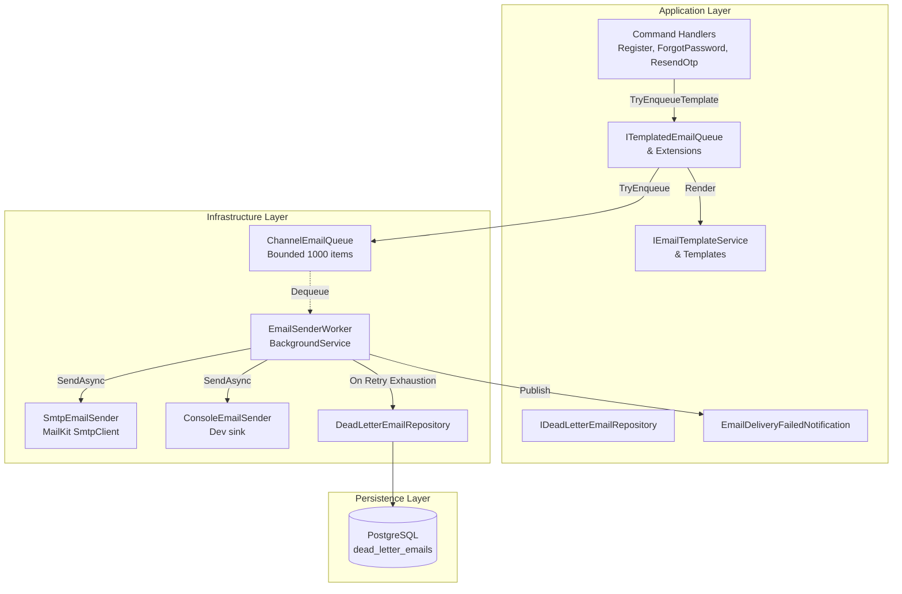

# Design Document: Real Email Delivery & Service Templating

**Feature**: `003-email-service-templating` | **Date**: 2026-11-14 | **Status**: Implemented

## 1. Overview & Architectural Goals

The CS Raiders platform requires a production-grade, extensible, and secure email subsystem for critical identity workflows including registration verification, password resets, and account security notices.

This architecture achieves five core objectives:
1. **Real Mail Transport**: Abstracted, RFC-compliant email transmission via MailKit over encrypted SMTP (TLS/STARTTLS), with configurable non-production modes (`ConsoleEmailSender`).
2. **Object-Oriented Service Templating**: Strongly typed template strategies (`IEmailTemplate<in TModel>`) producing responsive HTML and plain-text fallback content, with automatic dynamic input sanitization against HTML injection.
3. **Ergonomic Queue Integration**: Non-blocking atomic rendering and enqueueing (`ITemplatedEmailQueue` and `TryEnqueueTemplate` extensions) preserving bounded channel backpressure semantics.
4. **Resilient Delivery & Dead-Letter Storage**: Background worker with exponential backoff retries (0s, 1s, 5s), durable PostgreSQL dead-letter persistence (`DeadLetterEmail`), and in-process failure events (`EmailDeliveryFailedNotification`).
5. **Security & Privacy Invariants**: Recipient masking in diagnostic logs, zero body/secret leakage, and strictly outbound transactional message handling (no attachments, no inbound webhooks).

---

## 2. Component Architecture



---

## 3. Core Abstractions & Contracts

### 3.1. Template Strategy (`IEmailTemplate<in TModel>`)
```csharp
namespace CsRaiders.Api.Application.Common.Interfaces.Security;

public interface IEmailTemplate<in TModel>
{
    EmailPurpose Purpose { get; }
    string BuildSubject(TModel model);
    string RenderHtml(TModel model);
    string RenderText(TModel model);
}
```

Built-in implementations:
- `RegistrationOtpTemplate : IEmailTemplate<RegistrationOtpTemplateModel>`
- `PasswordResetTemplate : IEmailTemplate<PasswordResetTemplateModel>`
- `SecurityNoticeTemplate : IEmailTemplate<SecurityNoticeTemplateModel>`

### 3.2. Template Service (`IEmailTemplateService`)
Renders templates and constructs immutable `EmailMessage` domain entities, validating and normalizing recipient email addresses:
```csharp
public sealed record EmailContent(string Subject, string BodyHtml, string BodyText);

public interface IEmailTemplateService
{
    EmailContent Render<TModel>(IEmailTemplate<TModel> template, TModel model);
    EmailMessage CreateMessage<TModel>(string recipient, IEmailTemplate<TModel> template, TModel model, string? correlationId = null);
}
```

### 3.3. Queue Facade & Extension (`ITemplatedEmailQueue`)
Provides non-blocking enqueueing returning `false` immediately when saturated:
```csharp
public interface ITemplatedEmailQueue
{
    bool TryEnqueueTemplate<TModel>(string recipient, IEmailTemplate<TModel> template, TModel model, string? correlationId = null);
    bool TryEnqueue(EmailMessage message);
}
```

---

## 4. Resilience & Dead-Letter Persistence

When email transmission experiences transient network or mail server errors, `EmailSenderWorker` retries up to 3 attempts with progressive backoff:
- **Attempt 1**: Immediate (0s delay)
- **Attempt 2**: 1s delay
- **Attempt 3**: 5s delay

On final retry exhaustion:
1. Increment metric `email_queue.dead_letter`.
2. Persist `DeadLetterEmail` entity in PostgreSQL table `dead_letter_emails` containing recipient, subject, purpose, sanitized error reason, attempt count, correlation ID, and failure timestamp.
3. Publish `EmailDeliveryFailedNotification` via Mediator in-process bus for operational alerting.
4. Cleanly proceed to subsequent queued messages without crashing the background worker.

---

## 5. Security & Privacy Guarantees

1. **HTML Escaping**: Dynamic inputs in template models are sanitized via `WebUtility.HtmlEncode`, protecting against markup and script injection.
2. **Log Redaction**: Recipient email addresses are masked (`j***e@domain.com`). Raw message bodies, passwords, and verification OTPs are never logged.
3. **Bounded Channels**: In-process queues are bounded (1000 items) to prevent denial-of-service memory exhaustion during delivery spikes.
4. **Architecture Separation**: Domain and Application layers maintain zero dependencies on `MailKit` or `MimeKit`.
