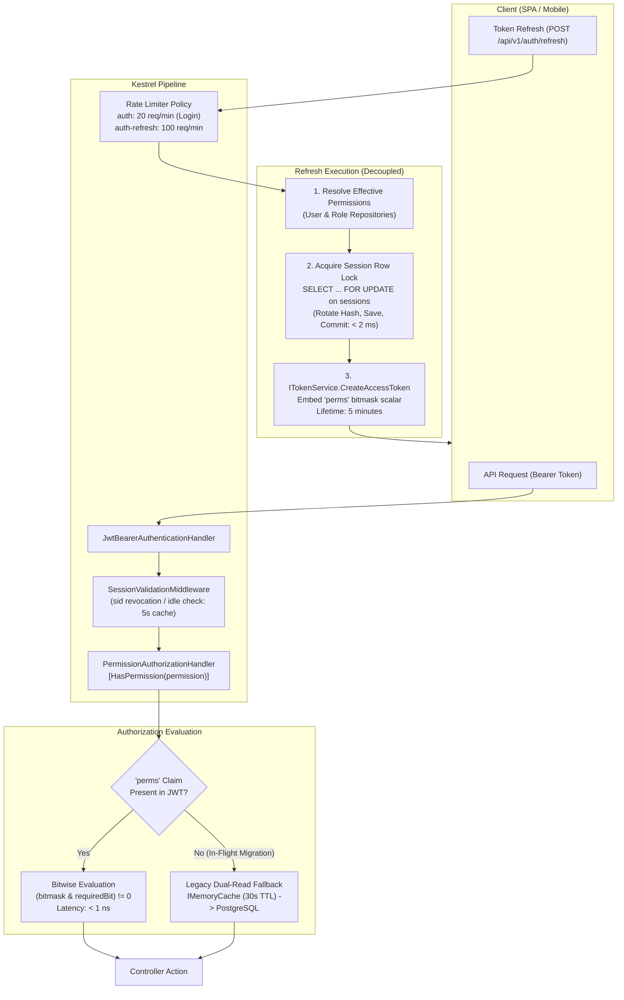

# Token-Embedded Authorization Bitmask Claims

*   **Author:** ahmniab
*   **Status:** Reviewed
*   **Date:** 2026-11-11

--------------------------------------------------------------------------------

## Overview

This feature optimizes endpoint authorization checks in `CsRaiders.Api` by embedding user effective permissions directly into JWT access token claims as a compact 32-bit unsigned integer bitmask scalar (`perms`). 

Instead of serializing permission strings into the token or performing local in-memory cache lookups on every request, `PermissionAuthorizationHandler` evaluates permissions locally using a bitwise AND operation (`(bitmask & requiredPermissionBit) != 0`). Access token lifetime is set to 5 minutes to bound permission propagation delay to 5 minutes while user sessions remain long-lived.

## The Problem

1. **Authorization Cache & Query Overhead**: In `PermissionAuthorizationHandler.cs`, every request decorated with `[HasPermission]` constructs a cache key (`perms:{userId}`) and queries `IMemoryCache`. On cache misses (or when the cache token is invalidated), it executes multiple split queries across `users`, `user_roles`, and `user_permissions` in PostgreSQL.
2. **String-Based Token Bloat**: `PermissionCatalog.cs` defines 20 granular permissions. Serializing these permission strings into JWT claims inflates the `Authorization: Bearer` header to 1.5+ KB, consuming unnecessary network bandwidth and risking HTTP `431 Request Header Fields Too Large` rejections from reverse proxies and edge gateways (Cloudflare, AWS ALB, Nginx).
3. **Database Write Contention on Refresh**: Reducing access token lifetime to 5 minutes triples the frequency of client calls to `POST /api/v1/auth/refresh`. In `RefreshTokenCommandHandler.cs`, token refresh executes an exclusive pessimistic row lock (`SELECT ... FOR UPDATE` on `sessions`). Resolving user permissions inside this lock would increase lock hold duration, tie up PostgreSQL connections, and trigger database connection pool starvation.
4. **NAT Rate Limiting Risk**: `CsRaidersApiServiceExtensions.cs` applies a fixed-window rate limiter of 20 requests per minute per IP address across all `/api/v1/auth` routes. With 5-minute access tokens, multiple users sharing a corporate, campus, or cellular NAT gateway will exceed 20 refresh requests per minute, triggering cascading HTTP 429 lockouts.
5. **In-Flight Token Incompatibility**: Active tokens issued prior to deployment contain only `sub` and `sid`. A hard switch to bitmask claim inspection would cause immediate HTTP 403 authorization failures for all active users during a rolling deployment.

## Goals

* **Eliminate In-Memory & Database Lookups on Endpoints**: Evaluate `[HasPermission]` authorization locally in `PermissionAuthorizationHandler` via bitwise operations without accessing `IMemoryCache` or PostgreSQL when the bitmask claim is present.
* **Keep Token Size Minimal**: Encode up to 32 permissions into a single scalar integer claim (`perms`), keeping total JWT size under 300 bytes.
* **Zero-Downtime Deployment**: Provide a dual-read fallback in `PermissionAuthorizationHandler` that processes legacy tokens lacking the `perms` claim via `IMemoryCache` until they expire.
* **Bounded Permission Propagation Window**: Bound administrative permission modification lag to 5 minutes (+ 30 seconds clock skew tolerance) without affecting overall user session duration.
* **Protect Database Connection Pool**: Resolve user permissions outside the `sessions` row-lock transaction in `RefreshTokenCommandHandler` to keep lock hold time below 2 milliseconds.
* **NAT Resilience**: Partition or adjust rate limiting on `/api/v1/auth/refresh` to prevent false-positive 429 lockouts for multi-user NAT networks.

## Non-Goals

* **Zero-Latency (0 ms) Permission De-escalation**: Immediate permission de-escalation across active access tokens is not guaranteed (accepted bound: 5 minutes + clock skew until next automatic token refresh).
* **Removing Session Validation Middleware**: `SessionValidationMiddleware.cs` will remain active on every request to enforce session revocation, idle timeouts, and single-session rules.
* **Arbitrary Permission Expansion Beyond 64 Flags**: The bitmask allocation will support up to 32 permissions using `uint` (expandable to 64 using `ulong`), but will not support dynamic, unbounded string claims without a schema revision.

## Open Questions

* **Bitmask Encoding Format**: Should the `perms` claim be encoded as a decimal integer string (e.g., `"15"`) or a hexadecimal string (e.g., `"0x000F"`) in the JWT payload to balance JSON serialization size and parsing speed in .NET?
Answer: Incode the  mask as a normal decimal integer not a string.
* **Refresh Rate Limiter Strategy**: Should `/api/v1/auth/refresh` be partitioned from `/api/v1/auth/login` by increasing the IP rate limit (e.g., to 100 req/min per IP) or by applying a per-session/per-user rate limiting policy?
Answer: keep the rate limiting logic as exist.

## Critical User Journeys (CUJs)

### CUJ 1: Authenticated API Request with Bitmask Token
* **Given**: A user holds a valid 5-minute access token containing the `perms` bitmask claim.
* **When**: The user calls an endpoint decorated with `[HasPermission("UsersRead")]`.
* **Then**: `PermissionAuthorizationHandler` extracts the integer `perms` claim, computes `(bitmask & UsersReadBit) != 0`, and succeeds immediately without touching `IMemoryCache` or PostgreSQL.

### CUJ 2: Zero-Downtime In-Flight Legacy Token Request
* **Given**: A user holds a valid 15-minute access token issued before the bitmask deployment (containing only `sub` and `sid`).
* **When**: The user calls an endpoint decorated with `[HasPermission("RolesRead")]`.
* **Then**: `PermissionAuthorizationHandler` detects that the `perms` claim is missing, routes execution to the legacy `IMemoryCache`/database fallback, and authorizes the request without throwing HTTP 403.

### CUJ 3: Concurrency-Safe Token Refresh
* **Given**: A user's access token is nearing its 5-minute expiration.
* **When**: The client calls `POST /api/v1/auth/refresh` with its refresh token cookie.
* **Then**: `RefreshTokenCommandHandler` resolves the user's latest permissions prior to acquiring the pessimistic row lock on `sessions`. The row lock executes only the cryptographic hash verification and rotation, issues a new 5-minute access token containing the updated `perms` bitmask, and commits within 2 ms.

--------------------------------------------------------------------------------

## Technical Plan (Architecture)

### 1. Architectural Overview & Component Boundaries

The architecture introduces a compact, scalar permission representation that eliminates endpoint authorization lookups while safeguarding token size and database lock hold times.



### 2. Domain Model & Capability Bitmask Mapping

In `CsRaiders.Api.Domain.Constants`, introduce `PermissionBits` as a flags enum backed by `uint` (32-bit unsigned integer), mapping every permission currently defined in `PermissionCatalog.cs`:

```csharp
[Flags]
public enum PermissionBits : uint
{
    None                     = 0,
    UsersRead                = 1u << 0,
    UsersCreate              = 1u << 1,
    UsersUpdate              = 1u << 2,
    UsersDelete              = 1u << 3,
    RolesRead                = 1u << 4,
    RolesManage              = 1u << 5,
    PermissionsManage        = 1u << 6,
    CoursesRead              = 1u << 7,
    CoursesCreate            = 1u << 8,
    CoursesUpdate            = 1u << 9,
    CoursesDelete            = 1u << 10,
    EnrollmentsRead          = 1u << 11,
    EnrollmentsManage        = 1u << 12,
    AssessmentsRead          = 1u << 13,
    AssessmentsSubmit        = 1u << 14,
    AssessmentsGrade         = 1u << 15,
    AuditLogsRead            = 1u << 16,
    SystemMetricsRead        = 1u << 17,
    ReportsGenerate          = 1u << 18,
    SecurityEventsRead       = 1u << 19
}
```

A static helper `PermissionBitmaskMapper` in `CsRaiders.Api.Domain` provides bidirectional translation between permission name strings and their respective bit representations:
* `PermissionBits ToBitmask(IEnumerable<string> permissionNames)`: Aggregates an enumerable of permission string names into a single `uint` scalar via bitwise OR.
* `PermissionBits GetBit(string permissionName)`: Returns the single bit corresponding to the specified permission string.
* `bool HasPermission(uint bitmask, PermissionBits requiredBit)`: Evaluates `(bitmask & (uint)requiredBit) != 0`.

### 3. Token Generation & Claim Contract

1. **`ITokenService` Interface Update**:
   Update `ITokenService.CreateAccessToken` to accept the precomputed permissions bitmask:
   ```csharp
   string CreateAccessToken(Guid userId, Guid sessionId, uint permissionsBitmask, DateTimeOffset now);
   ```

2. **`TokenService` Implementation**:
   In `CsRaiders.Api.Infrastructure.Security.TokenService`, include the bitmask as a single standard string claim:
   ```csharp
   new Claim("perms", permissionsBitmask.ToString(CultureInfo.InvariantCulture))
   ```
   *Claim Payload Overhead*: Using a decimal integer scalar string (e.g., `"1048575"` for all 20 permissions active) takes only 7–10 bytes in the JWT payload. The overall access token remains under 280 bytes.

3. **Configurable Token Lifetime**:
   In `AuthRules.cs`, update `AccessTokenLifetime` from 15 minutes to 5 minutes:
   ```csharp
   public static readonly TimeSpan AccessTokenLifetime = TimeSpan.FromMinutes(5);
   ```
   Optionally allow overriding via `IConfiguration["Auth:AccessTokenLifetimeMinutes"]` to facilitate gradual rollout and emergency rollback without code deployment.

### 4. Endpoint Authorization & Dual-Read Migration

In `CsRaiders.Api.API.Authorization.PermissionAuthorizationHandler`:

1. **Bitmask Path (Fast Path)**:
   Extract the `"perms"` claim from `context.User`:
   ```csharp
   var permsClaim = context.User.FindFirst("perms");
   if (permsClaim != null && uint.TryParse(permsClaim.Value, NumberStyles.Integer, CultureInfo.InvariantCulture, out var bitmask))
   {
       var requiredBit = PermissionBitmaskMapper.GetBit(requirement.Permission);
       if ((bitmask & (uint)requiredBit) != 0)
       {
           context.Succeed(requirement);
       }
       return Task.CompletedTask;
   }
   ```
   If the claim is present and valid, authorization completes in < 1 nanosecond with zero allocations and zero I/O.

2. **Dual-Read Fallback Path (Zero-Downtime Migration)**:
   If `permsClaim` is null (indicating a legacy token issued before deployment):
   * Fall back to the existing `IMemoryCache` lookup (`perms:{userId}`) and database repository query.
   * This guarantees that rolling server updates do not trigger 403 errors on active client sessions during the 15-minute drain period of legacy tokens.

### 5. Refresh Command Handler Optimization (Lock Decoupling)

To prevent database write contention and connection pool exhaustion:

In `RefreshTokenCommandHandler.cs`:
1. **Pre-Lock Permission Resolution**:
   Extract `sessionId` from the refresh token hash or load the session without pessimistic locking. Retrieve the `userId` and resolve effective permissions via `IUserRepository` and `IRoleRepository`.
2. **Minimized Pessimistic Lock**:
   Acquire the row lock via `ISessionRepository.FindByIdForUpdateAsync(sessionId)`.
   Execute strictly the state mutations:
   * Verify token hash and expiration.
   * Execute `session.TryRotate(...)`.
   * Persist session state update via `_sessionRepository.UpdateAsync(session)`.
3. **Commit & Token Issuance**:
   Commit the transaction immediately, releasing the row lock in < 2 ms.
   Invoke `_tokenService.CreateAccessToken(session.UserId, session.Id, permissionsBitmask, now)`.

### 6. Rate Limiting Partitioning for NAT Networks

In `CsRaidersApiServiceExtensions.cs`, separate the rate limiting policies for authentication routes:

1. **`auth-login` Policy**: Retain the strict `20 requests per minute per IP` limiter for `/api/v1/auth/login` and `/api/v1/auth/register` to prevent credential brute-forcing.
2. **`auth-refresh` Policy**: Assign a dedicated rate limiter for `/api/v1/auth/refresh`:
   * Set permit limit to `100 requests per minute per IP` (or partition by session identifier extracted from request cookie/header).
   * This prevents false-positive HTTP 429 lockouts when multiple active users behind an office, university, or mobile NAT gateway refresh tokens every 5 minutes.

--------------------------------------------------------------------------------

## Alternatives Considered

### Alternative A: Embed Raw Permission Strings in 5-Minute Access Tokens

*   **Pros**: Highly readable claim payloads; simplifies ad-hoc debugging when decoding JWTs in external debugging tools; does not require enum or bitwise translation layers.
*   **Cons**: Serializing 20 distinct strings (e.g., `PermissionsManage`, `SecurityEventsRead`) expands the JWT to 1.5–2.5 KB. Appending this payload to every HTTP `Authorization: Bearer` header causes substantial network ingress/egress bloat and risks edge proxy rejections (`HTTP 431 Request Header Fields Too Large` or `400 Bad Request` on Cloudflare, AWS ALB, and Nginx).
*   **Reason for Rejection**: Rejected by author: Serializing raw permission strings causes unmitigated HTTP header bloat and bandwidth egress costs with zero functional benefit over a compact 32-bit scalar bitmask.

### Alternative B: Extend In-Memory Cache TTL to 5 Minutes in `PermissionAuthorizationHandler.cs`

*   **Pros**: Minimal code footprint (single-line change in `PermissionAuthorizationHandler.cs`); access tokens remain tiny (~200 B); zero increase in refresh transaction frequency; preserves 0 ms instant revocation via `IRbacInvalidationToken.Invalidate()`.
*   **Cons**: Does not eliminate per-request in-memory dictionary lookups or cache key formatting; requires in-memory state coordination in multi-node clusters (or accept node-local invalidation delay).
*   **Reason for Rejection**: Rejected by author: The objective is to decouple endpoint authorization entirely from local memory cache lookups and evaluate permissions strictly via self-contained claims on the authenticated identity.

### Alternative C: Database Queries on Every Request with No Caching

*   **Pros**: Absolute real-time consistency; instantly reflects database mutations across any number of stateless API replicas.
*   **Cons**: Executes multiple split queries across `users`, `user_roles`, and `user_permissions` on every single protected API invocation, rapidly saturating PostgreSQL connection pools and causing cascading request timeouts under normal traffic.
*   **Reason for Rejection**: Rejected by author: Directly contradicts the fundamental objective to eliminate database query overhead and prevent connection pool starvation.

--------------------------------------------------------------------------------

## Non-Functional Requirements

### Security & Privacy
* **Session Lifetime vs. Access Token Lifetime**:
  * **User Sessions are NOT revoked after 5 minutes**: User sessions remain long-lived (governed by refresh token expiration in `AuthRules.cs`, e.g., 7 days sliding / 30 days absolute). The user is never logged out after 5 minutes.
  * **Automatic Background Refresh**: When an access token reaches its 5-minute expiry, the frontend client automatically calls `POST /api/v1/auth/refresh` silently in the background, rotating the token and receiving a fresh 5-minute access token without user friction.
* **Permission Propagation Window (5-Minute Maximum)**:
  * Because permissions are stored in the access token to avoid per-request database lookups, administrative role changes or permission revocations take up to 5 minutes (+ 30 seconds clock skew tolerance) to reflect in the active access token. When the client refreshes, the new token contains the updated bitmask.
* **Instant Session Invalidation (Immediate Logout / Ban)**:
  * Account suspension, password resets, and explicit session termination continue to take effect within 5 seconds because `SessionValidationMiddleware.cs` executes on every request and checks session validity against `ISessionStatusReader`.
* **Tamper-Proof Claims**: The `perms` claim is cryptographically signed using HMAC-SHA256 via `TokenValidationParameters.IssuerSigningKey`. Clients cannot modify bits without invalidating the cryptographic signature.

### Performance & Latency
* **Endpoint Evaluation**: Local bitwise operations take < 1 nanosecond with zero heap allocations, zero lock contention, and zero I/O.
* **Token Size**: Access tokens remain under 280 bytes, well below reverse proxy header size thresholds (typically 4 KB–8 KB).
* **Database Row-Lock Duration**: Refresh commands hold `SELECT ... FOR UPDATE` locks on `sessions` for < 2 milliseconds by executing permission resolution prior to transaction lock acquisition.

### Rollout & Rollback
* **Zero-Downtime Rolling Upgrade**: The dual-read fallback in `PermissionAuthorizationHandler` ensures that nodes running the new version can seamlessly process legacy tokens issued by previous nodes without throwing HTTP 403 errors.
* **Rollback Safety**: Reverting to 15-minute tokens without bitmask claims can be executed instantly via configuration (`Auth:AccessTokenLifetimeMinutes`) without requiring database schema rollbacks or data migrations.

--------------------------------------------------------------------------------

### Additional Resources

* `src/CsRaiders.Api.Domain/Constants/PermissionCatalog.cs`: Source of truth for all 20 system permission strings.
* `src/CsRaiders.Api.Domain/Constants/AuthRules.cs`: Access token lifetimes, replay grace windows, and session limits.
* `src/CsRaiders.Api.API/Authorization/PermissionAuthorizationHandler.cs`: Current in-memory authorization handler.
* `src/CsRaiders.Api.Application/Features/Auth/Commands/Refresh/RefreshTokenCommand.cs`: Session rotation and token issuance handler.

### Future Improvements

* **64-Bit Permission Expansion**: If the catalog grows beyond 32 distinct permissions, `PermissionBits` can be transitioned from `uint` to `ulong` (64 bits) without changing the single-claim string representation in the JWT payload.

--------------------------------------------------------------------------------

## Detailed Implementation Plan

### Target Files to Create/Modify

#### 1. `src/CsRaiders.Api.Domain/Constants/PermissionBits.cs` (Create)
* **Type / Scope**: C# Domain Flags Enum
* **Rationale**: Establishes the canonical 32-bit scalar representation for all 20 permissions defined in `PermissionCatalog.cs`, supporting sub-nanosecond bitwise checks.
* **Contract / Public Surface**:
  - `[Flags] public enum PermissionBits : uint { None = 0, UsersRead = 1u << 0, ... SecurityEventsRead = 1u << 19 }`

#### 2. `src/CsRaiders.Api.Domain/Constants/PermissionBitmaskMapper.cs` (Create)
* **Type / Scope**: C# Domain Static Utility
* **Rationale**: Encapsulates bidirectional mapping between string permission names and `PermissionBits` scalars.
* **Contract / Public Surface**:
  - `public static PermissionBits ToBitmask(IEnumerable<string> permissionNames)`
  - `public static PermissionBits GetBit(string permissionName)`
  - `public static bool HasPermission(uint bitmask, PermissionBits requiredBit)`

#### 3. `src/CsRaiders.Api.Domain/Constants/AuthRules.cs` (Modify)
* **Type / Scope**: C# Domain Constants
* **Rationale**: Updates default `AccessTokenLifetime` to 5 minutes to enforce the bounded permission propagation window.
* **Contract / Public Surface**:
  - Update: `public static readonly TimeSpan AccessTokenLifetime = TimeSpan.FromMinutes(5);`

#### 4. `src/CsRaiders.Api.Domain/Constants/README.md` (Modify)
* **Type / Scope**: Documentation / Component Contract
* **Rationale**: Documents `PermissionBits`, `PermissionBitmaskMapper`, and the 5-minute access token lifetime in domain constants contract.

#### 5. `src/CsRaiders.Api.Application/Common/Interfaces/Security/ITokenService.cs` (Modify)
* **Type / Scope**: C# Application Interface
* **Rationale**: Expands `CreateAccessToken` signature to accept the precomputed `uint permissionsBitmask`.
* **Contract / Public Surface**:
  - Update: `string CreateAccessToken(Guid userId, Guid sessionId, uint permissionsBitmask, DateTimeOffset now);`

#### 6. `src/CsRaiders.Api.Application/Common/Interfaces/Security/README.md` (Modify)
* **Type / Scope**: Documentation / Component Contract
* **Rationale**: Documents the updated `CreateAccessToken` method signature and parameters.

#### 7. `src/CsRaiders.Api.Application/Features/Auth/Commands/Login/LoginCommand.cs` (Modify)
* **Type / Scope**: C# Application Command Handler
* **Rationale**: Resolves user effective permissions via `IUserRepository` and `IRoleRepository` upon successful authentication, converts them to a bitmask via `PermissionBitmaskMapper.ToBitmask`, and supplies it to `CreateAccessToken`.

#### 8. `src/CsRaiders.Api.Application/Features/Auth/Commands/Login/README.md` (Modify)
* **Type / Scope**: Documentation / Component Contract
* **Rationale**: Documents permission bitmask resolution during user login.

#### 9. `src/CsRaiders.Api.Application/Features/Auth/Commands/Refresh/RefreshTokenCommand.cs` (Modify)
* **Type / Scope**: C# Application Command Handler
* **Rationale**: Decouples permission resolution from the pessimistic `sessions` row lock: resolves effective permissions before transaction lock acquisition, executes row-lock rotation within 2 ms, and issues the access token containing the updated bitmask.

#### 10. `src/CsRaiders.Api.Application/Features/Auth/Commands/Refresh/README.md` (Modify)
* **Type / Scope**: Documentation / Component Contract
* **Rationale**: Documents decoupled permission resolution and bitmask claim generation during token refresh.

#### 11. `src/CsRaiders.Api.Infrastructure/Security/TokenService.cs` (Modify)
* **Type / Scope**: C# Infrastructure Service
* **Rationale**: Emits the `"perms"` claim as a decimal scalar string (`permissionsBitmask.ToString(CultureInfo.InvariantCulture)`) in the JWT claims identity.

#### 12. `src/CsRaiders.Api.Infrastructure/Security/README.md` (Modify)
* **Type / Scope**: Documentation / Component Contract
* **Rationale**: Documents `"perms"` claim emission and token size guarantees.

#### 13. `src/CsRaiders.Api.API/Authorization/PermissionAuthorizationHandler.cs` (Modify)
* **Type / Scope**: C# API Authorization Handler
* **Rationale**: Implements dual-read evaluation: extracts `"perms"` claim for local bitwise evaluation; falls back to `IMemoryCache` lookup for legacy in-flight tokens lacking the claim.

#### 14. `src/CsRaiders.Api.API/Authorization/HasPermissionAttribute.cs` (Modify)
* **Type / Scope**: C# API Attribute
* **Rationale**: Updates class docstring to reflect that permissions are now evaluated against token bitmask claims while retaining attribute declarative syntax.

#### 15. `src/CsRaiders.Api.API/Authorization/README.md` (Modify)
* **Type / Scope**: Documentation / Component Contract
* **Rationale**: Documents bitwise requirement verification and dual-read fallback in the authorization handler contract.

#### 16. `src/CsRaiders.Api.API/Extensions/CsRaidersApiServiceExtensions.cs` (Modify)
* **Type / Scope**: C# API Service Configuration
* **Rationale**: Partitions rate limiting: preserves 20 req/min for login and registration, and assigns a dedicated 100 req/min partition for `/api/v1/auth/refresh` to prevent false-positive lockouts on shared NAT networks.

#### 17. `src/CsRaiders.Api.API/Extensions/README.md` (Modify)
* **Type / Scope**: Documentation / Component Contract
* **Rationale**: Documents partitioned authentication rate limiting policies.

#### 18. `tests/CsRaiders.Api.UnitTests/Domain/PermissionBitmaskMapperTests.cs` (Create)
* **Type / Scope**: C# Unit Tests
* **Rationale**: Tests bidirectional mapping for all 20 permissions, multiple bitmask aggregation, and flag evaluation.

#### 19. `tests/CsRaiders.Api.UnitTests/API/PermissionAuthorizationHandlerTests.cs` (Modify)
* **Type / Scope**: C# Unit Tests
* **Rationale**: Tests both handler paths: sub-nanosecond bitwise evaluation on bitmask tokens (verifying zero cache/database interaction), and dual-read fallback on legacy tokens lacking `"perms"`.
