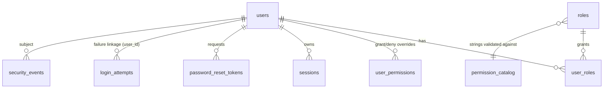

# Phase 1 Data Model: Authentication & Session Management

Feature: `001-auth-session-management` · Date: 2026-11-08

Authoritative store: PostgreSQL 16 (citext extension enabled). Existing tables come from migration `20261105144818_Auth_Initial`; deltas are marked **NEW** (see `research.md` §"Schema/code deltas"). Identifiers are application-assigned (`IdGenerator`).

---

## Entities (all already in `CsRaiders.Api.Domain` unless marked NEW)

### User — `users`
| Field | Type / constraint | Rules |
|---|---|---|
| Id | Guid PK | app-assigned |
| Email | citext, unique (`ux_users_email`) | case-insensitive uniqueness; value-object validated |
| Name | text | 1–200 chars (trimmed) |
| PasswordHash | text | `PasswordHashGuard` enforces Argon2id PHC prefix; **pepper version embedded via PHC `p=<v>` extension (D1)** |
| Status | enum→`active|suspended|deleted` | check constraint `ck_users_status` |
| EmailVerifiedAt, PasswordChangedAt, CreatedAt, DeletedAt | timestamptz | state/perf hygiene |

**State machine**: `active ⇄ suspended` (`Suspend`/`Reactivate`); `→ deleted` (soft only). `CanAuthenticate` == active ∧ not deleted. Suspension ⇒ all sessions revoked (`account_disabled`) + cache evictions (FR-028 in spec numbering).
Role links: `user_roles` (user, role, granted_by?); per-user overrides: `user_permissions` (permission, effect grant|deny, granted_by?) — update-in-place semantics so EF never delete+inserts the same key.

### Role — `roles`
Name, Slug (unique), Scope (`student|staff`), `permissions` string[] with GIN index, IsSystem. Five system presets seeded (Student, Support Agent, Content Manager, Administrator, Super Admin) — `session:multi` deliberately absent from Student preset (existing safety belt). Student-scope roles may only ever hold `PermissionCatalog.StudentAllowed`.

### Session — `sessions`
| Field | Type | Rules |
|---|---|---|
| Id | Guid PK | the `sid` claim value everywhere |
| UserId | Guid FK | supersede/lock keyed on it |
| RefreshTokenHash / PreviousRefreshTokenHash | bytea(32) | SHA-256 of opaque 32-byte Base64Url token; hot-filtered indexes |
| RotatedAt | timestamptz? | drives the 15 s grace window (D5) |
| DeviceFp | text | opaque random device cookie value (D6); exact-match required at refresh |
| Ip, UserAgent(≤512) | record | display in session list only |
| IsStudentSession, EnforceSingleSession | bool | snapshot at issue time |
| CreatedAt, LastSeenAt, IdleExpiresAt (14 d), ExpiresAt (30 d) | timestamptz | `IsActive = !revoked ∧ now<exp ∧ now<idle` |
| RevokedAt, RevokeReason | | idempotent first-reason-wins; reason enum: superseded, cap_exceeded, policy_reduced, reuse_detected, logout, password_reset, admin_revoked, account_disabled |

**State machine**: `active → revoked(superseded | cap_exceeded | policy_reduced | reuse_detected | logout | password_reset | admin_revoked | account_disabled)`; active expires at min(expires_at, idle_expires_at). Created under per-user advisory lock with `uq_sessions_one_active` partial unique backstop. Cache: `session:status:{sid}` absolute 5 s + explicit eviction on every commit that revokes/data-changes.

### LoginAttempt — `login_attempts` (delta: composite PK)
**NEW PK**: `(email_norm, ip)` — was unique(email) (D8). Fields per row: failed_count, first_failure_at, delay_until, locked_until, updated_at, user_id? (known account linkage). Gates: delay 2^(n−3) s (cap 15 s) after failure 3; lock 15 min at failure 10; window 15 min; evaluate **before** password hashing; global per-email soft limit = ≥30 failures / 15 min across all IPs → delay only. On success/reset: pair row counters reset.
**State machine**: `open → throttled(delay_until > now) → open … → locked(locked_until > now) → open(reset)`.

### PendingRegistration — `pending_registrations`
Email (unique), Name, PasswordHash, OtpHash (HMAC-SHA256 over `email:otp`), AttemptsLeft (5), SendCountWindow + SendWindowStartedAt (5/hour, 1-hour window), ResendAvailableAt (+60 s), ExpiresAt (+10 min), DeviceFp?, CreatedAt. On re-register of a still-valid pending email: **never overwrite stored password** — treat as resend (FR-005) via `Reissue` when cooldown allows. Verify: fixed-time compare, attempts decrement even on rejection, expiry/attempt checks first. Cleaned when expired (job).
**State machine**: `pending → verified(user created + row purge) | expired | attempts_exhausted`.

### PasswordResetToken — `password_reset_tokens`
UserId FK, TokenHash (SHA-256 32-byte, unique hot), ExpiresAt (+30 min), UsedAt?. Single-use constant-time comparison; a new request supersedes any prior unused token (FR-023); successful use revokes **all** sessions (`password_reset`); purged ≥7 d after use/expiry.

### AppSetting — `app_settings` (NEW)
`key` text PK, `value` text, `updated_at`. Carries `session.multi_max_concurrent` (default 3). Read-through on login/validation with a short local cache; admin writes evict.

### SecurityEvent — `security_events` (NEW)
Id Guid PK, EventName (`login_locked_out`, `login_throttled`, `otp_failed`, `otp_resend`, `token_reuse_detected`, `account_suspended`, `account_reactivated`, `role_changed`, `permission_override_changed`, `session_revoked`, `password_changed`, `password_reset_requested`, `password_reset_completed`), UserId?, Email?(citext-ready), Ip?, Details JSONB (redacted by D10 deny-list), CreatedAt (+index for the 30-day purge). Writes are isolated (own connection, `SecurityAuditWriter`), never rolled back by command transactions.

### EmailMessage (in memory only — Channel item, not persisted)
To (redacted in logs), Subject, Body, Purpose (`registration_otp`, `password_reset`, `account_notice`), Tenant correlation; dropped on queue full with a warning counter.

---

## Relationships

`pending_registrations` is standalone (pre-user). `app_settings` standalone config.

## Permission model (evaluation rule)

Effective(u) = (permission union over u's roles ∪ grants[u]) ∖ denies[u] — implemented in `EffectivePermissions.Resolve` (deny wins). Guards: Student-scope role ⇛ StudentAllowed only; grant requires grantor hold; every RBAC mutation ⇒ global `perms:*` token cancel + affected session reconciliation (policy_reduced revoke older, newest single-session) when `session:multi` is lost.

## Uniqueness & race rules (recap)

1. `ux_users_email` (citext, unique) — case-insensitive identity.
2. `uq_sessions_one_active` — partial unique `(user_id) where revoked_at is null and enforce_single_session` — backstop under advisory-lock-serialized login (D4).
3. `ux_pending_email` — one pending register per email; second call = resend semantics.
4. `ux_password_reset_tokens_hash` — hot lookup; supersede-on-new-issue.
5. `login_attempts` composite PK — concurrent gate writes serialized by row lock within the login transaction.
