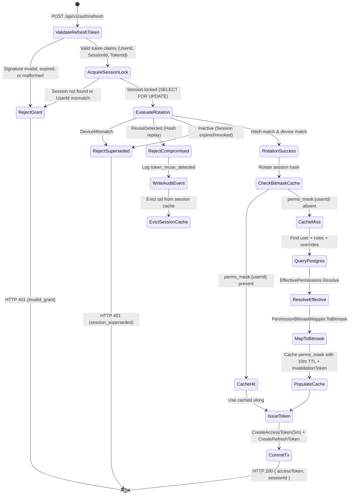
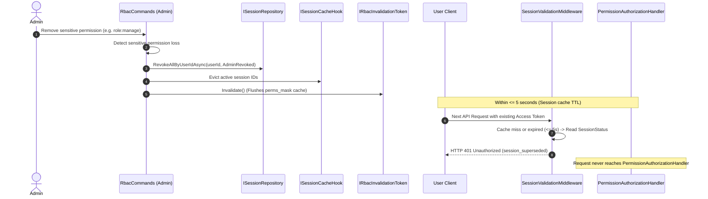

# Data Model: Token Bitmask Authorization

**Feature Branch**: `002-token-bitmask-authorization`  
**Date**: 2026-11-12  
**Status**: Completed  

---

## 1. Domain Entities & Value Types

### 1.1 `PermissionBits` (Domain Flags Enum)
- **Namespace**: `CsRaiders.Api.Domain.Constants`
- **Underlying Type**: `ulong` (`UInt64`)
- **Attributes**: `[Flags]`
- **Capacity**: Up to 64 distinct permission bits ($1\text{UL} \ll 0$ through $1\text{UL} \ll 63$).
- **Bit Mapping**:

| Enum Member | Bit Index | Bit Value (`ulong`) | Hex Mask | Permission String (Catalog) | Sensitive Capability |
|:---|:---|:---|:---|:---|:---|
| `None` | - | `0UL` | `0x0000000000000000` | - | No |
| `CourseRead` | 0 | `1UL << 0` | `0x0000000000000001` | `"course:read"` | No |
| `CourseWrite` | 1 | `1UL << 1` | `0x0000000000000002` | `"course:write"` | No |
| `CoursePurge` | 2 | `1UL << 2` | `0x0000000000000004` | `"course:purge"` | No |
| `LessonWrite` | 3 | `1UL << 3` | `0x0000000000000008` | `"lesson:write"` | No |
| `AssetWrite` | 4 | `1UL << 4` | `0x0000000000000010` | `"asset:write"` | No |
| `QuestionWrite` | 5 | `1UL << 5` | `0x0000000000000020` | `"question:write"` | No |
| `QuizWrite` | 6 | `1UL << 6` | `0x0000000000000040` | `"quiz:write"` | No |
| `UserRead` | 7 | `1UL << 7` | `0x0000000000000080` | `"user:read"` | No |
| `UserWrite` | 8 | `1UL << 8` | `0x0000000000000100` | `"user:write"` | **Yes** |
| `RoleManage` | 9 | `1UL << 9` | `0x0000000000000200` | `"role:manage"` | **Yes** |
| `PaymentRead` | 10 | `1UL << 10` | `0x0000000000000400` | `"payment:read"` | No |
| `PaymentVerify` | 11 | `1UL << 11` | `0x0000000000000800` | `"payment:verify"` | No |
| `PaymentRefund` | 12 | `1UL << 12` | `0x0000000000001000` | `"payment:refund"` | **Yes** |
| `NotificationSend` | 13 | `1UL << 13` | `0x0000000000002000` | `"notification:send"` | No |
| `AnalyticsRead` | 14 | `1UL << 14` | `0x0000000000004000` | `"analytics:read"` | No |
| `AuditRead` | 15 | `1UL << 15` | `0x0000000000008000` | `"audit:read"` | No |
| `SettingsRead` | 16 | `1UL << 16` | `0x0000000000010000` | `"settings:read"` | No |
| `SettingsWrite` | 17 | `1UL << 17` | `0x0000000000020000` | `"settings:write"` | No |
| `SessionMulti` | 18 | `1UL << 18` | `0x0000000000040000` | `"session:multi"` | No |
| `SessionRevoke` | 19 | `1UL << 19` | `0x0000000000080000` | `"session:revoke"` | **Yes** |

- **Catalog Total Mask**:
  $$\text{FullCatalogBitmask} = \sum_{i=0}^{19} 2^i = 2^{20} - 1 = 1,048,575 \quad (\texttt{0x000FFFFF})$$

---

### 1.2 `PermissionBitmaskMapper` (Domain Static Service)
- **Namespace**: `CsRaiders.Api.Domain.Constants`
- **Methods**:
  - `ulong ToBitmask(IEnumerable<string> permissionNames)`: Computes bitwise OR across all matched permission strings; ignores null, empty, or unrecognized strings.
  - `ulong GetBit(string permissionName)`: Returns the single `ulong` power of two for a given permission; returns `0UL` if null or unrecognized.
  - `bool HasPermission(ulong bitmask, ulong requiredBit)`: Returns `requiredBit != 0UL && (bitmask & requiredBit) != 0UL`.
  - `IReadOnlyList<string> ToPermissionNames(ulong bitmask)`: Returns array of recognized permission strings whose bit is set in `bitmask`.

---

### 1.3 `SensitivePermissions` (Security Classification)
- **Namespace**: `CsRaiders.Api.Domain.Constants`
- **Members**:
  - `PermissionCatalog.RoleManage` (`"role:manage"`)
  - `PermissionCatalog.PaymentRefund` (`"payment:refund"`)
  - `PermissionCatalog.UserWrite` (`"user:write"`)
  - `PermissionCatalog.SessionRevoke` (`"session:revoke"`)
- **Behavior Rule**: If any of these permissions are removed from a user (via role permission modification, role unassignment, or explicit `Deny` override), all active sessions for the user MUST be immediately revoked via `ISessionRepository.RevokeAllByUserIdAsync(targetUserId, SessionRevokeReason.AdminRevoked, now, ct)`.

---

## 2. Token & Security Claims Contract

### 2.1 JWT Access Token Structure
- **Format**: Signed JWT (JWS HMAC-SHA256)
- **Lifetime**: 5 minutes (`AuthRules.AccessTokenLifetime = TimeSpan.FromMinutes(5)`)
- **Clock Skew Tolerance**: 30 seconds

| Claim | Type | Format / Constraints | Example | Purpose |
|:---|:---|:---|:---|:---|
| `sub` | `string` | Standard GUID | `"4f6e4a2c-7b8c-4f10-9b48-382a9db261e4"` | Subject user ID |
| `sid` | `string` | Standard GUID | `"9b1deb4d-3b7d-4bad-9bdd-2b0d7b3dcb6d"` | Authenticated session ID |
| `perms` | `string` | Invariant unsigned base-10 integer string: `^[0-9]{1,20}$` | `"1048575"` | Compact 64-bit permission bitmask |
| `iat` | `numeric` | Unix Epoch timestamp (seconds) | `1794508800` | Issued at timestamp |
| `exp` | `numeric` | Unix Epoch timestamp (seconds) | `1794509100` | Expiration timestamp ($iat + 300\text{s}$) |
| `iss` | `string` | Configured `Site:Origin` | `"https://csraiders.com"` | Token issuer |
| `aud` | `string` | Configured `Site:Origin` | `"https://csraiders.com"` | Target audience |

### 2.2 Invariant Validation Rules for `"perms"` Claim
1. **Required Claim**: On endpoints decorated with `[HasPermission]`, `"perms"` claim MUST be present.
2. **Numeric Representation**: Claim value MUST contain exclusively ASCII decimal digits (`0-9`), parseable by `ulong.TryParse(..., NumberStyles.None, CultureInfo.InvariantCulture)`.
3. **Range**: Value must be within $[0, 18446744073709551615]$ ($0$ to $2^{64}-1$). Negative values, floating points, hex prefixes (`0x`), or whitespace MUST fail parsing.
4. **Unrecognized Bits**: Bits higher than defined catalog positions (bits 20..63) MUST NOT grant any recognized or unauthorized capability.
5. **Fail-Closed**: If `perms` is missing, unparseable, or lacks the required bit, authorization fails immediately with `context.Fail()`.

---

## 3. In-Memory Cache Model

### 3.1 Refresh Bitmask Memoization
- **Cache**: `Microsoft.Extensions.Caching.Memory.IMemoryCache`
- **Key Pattern**: `$"perms_mask:{userId:D}"`
- **Stored Value**: `ulong` (64-bit scalar bitmask)
- **Expiration Policy**:
  - `AbsoluteExpirationRelativeToNow`: 10 minutes.
  - `ChangeToken`: `new CancellationChangeToken(invalidation.CurrentToken)`.
- **Invalidation Trigger**:
  - `UpdateRolePermissionsCommandHandler`
  - `UpdateRoleCommandHandler`
  - `DeleteRoleCommandHandler`
  - `CreateRoleCommandHandler`
  - `SetUserPermissionOverrideCommandHandler`
  - `ElevateUserRolesCommandHandler`
  - All call `invalidation.Invalidate()`, clearing all cached user bitmasks instantaneously across the process.

---

## 4. State Transitions

### 4.1 Token Refresh & Concurrency State Machine

### 4.2 Sensitive Capability Revocation State Flow

