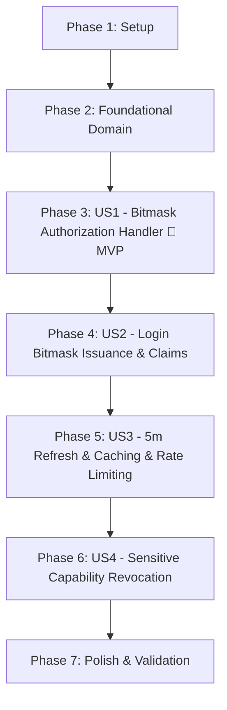

# Implementation Tasks: Token Bitmask Authorization

**Feature Branch**: `002-token-bitmask-authorization`  
**Date**: 2026-11-12  
**Spec**: [specs/002-token-bitmask-authorization/spec.md](file:///mnt/projects/web/backend/dotnet/CsRaiders.Api/specs/002-token-bitmask-authorization/spec.md)  
**Plan**: [specs/002-token-bitmask-authorization/plan.md](file:///mnt/projects/web/backend/dotnet/CsRaiders.Api/specs/002-token-bitmask-authorization/plan.md)  

---

## Phase 1: Setup (Shared Infrastructure)

**Purpose**: Baseline verification of project state and test suite before changes.

- [X] T001 Inspect and verify baseline build and test execution across all solution projects in CsRaiders.Api.sln

---

## Phase 2: Foundational (Blocking Prerequisites)

**Purpose**: Core domain types, mapping utilities, and unit tests that all user stories depend upon.

**⚠️ CRITICAL**: No user story work can begin until this phase is complete.

- [X] T002 [P] Define 64-bit domain flags enum `PermissionBits` mapping all 20 permissions with explicit powers of two (`1UL << 0` to `1UL << 19`) and `None = 0UL` in `src/CsRaiders.Api.Domain/Constants/PermissionBits.cs`
- [X] T003 [P] Implement static domain utility `PermissionBitmaskMapper` with `ToBitmask`, `GetBit`, `HasPermission`, and `ToPermissionNames` fail-closed methods in `src/CsRaiders.Api.Domain/Constants/PermissionBitmaskMapper.cs`
- [X] T004 [P] Create domain unit tests for `PermissionBitmaskMapper` covering bidirectional mapping, unknown/null strings, high bits, and flags evaluation in `tests/CsRaiders.Api.Domain.UnitTests/PermissionBitmaskMapperTests.cs`

**Checkpoint**: Core domain bitmask infrastructure complete and tested. User story implementations can proceed.

---

## Phase 3: User Story 1 - Authorize Protected Requests from the Access Token (Priority: P1) 🎯 MVP

**Goal**: Evaluate `[HasPermission]` authorization checks purely in memory using the access token's `perms` claim with zero database split queries or cache lookups.

**Independent Test**: Issue an access token containing a valid permission-mask claim, call a protected action requiring a represented permission, and confirm access is granted without a permission lookup; verify that missing or malformed claims are denied immediately without database fallback.

### Tests for User Story 1
- [X] T005 [P] [US1] Create integration tests verifying `PermissionAuthorizationHandler` allows authorized bitmask, denies missing bit, denies missing `"perms"` claim, and denies malformed claim with zero DB queries in `tests/CsRaiders.Api.IntegrationTests/PermissionAuthorizationHandlerTests.cs`

### Implementation for User Story 1
- [X] T006 [US1] Refactor `PermissionAuthorizationHandler` to remove dependencies on `IUserRepository`, `IRoleRepository`, `IMemoryCache`, `IRbacInvalidationToken`, and `IAuthMetricsRecorder`, and implement pure in-memory bitwise evaluation in `src/CsRaiders.Api.API/Authorization/PermissionAuthorizationHandler.cs`
- [X] T007 [P] [US1] Update docstring and metadata in `src/CsRaiders.Api.API/Authorization/HasPermissionAttribute.cs` stating permissions are evaluated in-memory from access token bitmask claims with zero database lookups

**Checkpoint**: User Story 1 is functional. Protected endpoints authorize in sub-microseconds with zero external I/O.

---

## Phase 4: User Story 2 - Receive Compact, Correct Permission Claims (Priority: P1)

**Goal**: Emit effective permissions in newly issued access tokens during sign-in as an invariant base-10 decimal integer string (`perms`), ensuring exact precision across server and JavaScript clients.

**Independent Test**: Sign in users with different role and individual permission assignments, inspect newly issued token claims, and verify each claim represents exactly their effective permissions as a decimal string without numeric precision loss.

### Tests for User Story 2
- [X] T008 [P] [US2] Add client `BigInt` bitwise contract verification test cases to `tests/CsRaiders.Api.Domain.UnitTests/PermissionBitmaskMapperTests.cs` proving identical allow/deny evaluation across all 20 catalog permissions without floating-point precision loss
- [X] T009 [P] [US2] Create unit tests for `LoginCommandHandler` verifying permission resolution, `perms_mask:{userId}` cache population, and scalar bitmask passing to `CreateAccessToken` in `tests/CsRaiders.Api.Application.UnitTests/Auth/LoginCommandHandlerTests.cs`

### Implementation for User Story 2
- [X] T010 [US2] Update `ITokenService` interface to accept `ulong permissionsBitmask` in `CreateAccessToken` in `src/CsRaiders.Api.Application/Common/Interfaces/Security/ITokenService.cs`
- [X] T011 [US2] Update `TokenService` to serialize `ulong permissionsBitmask` as an invariant base-10 decimal integer string in `"perms"` claim in `src/CsRaiders.Api.Infrastructure/Security/TokenService.cs`
- [X] T012 [US2] Update `LoginCommandHandler` to resolve effective permissions, compute bitmask, populate `perms_mask:{userId}` cache with `IRbacInvalidationToken` expiration, and supply bitmask to `tokens.CreateAccessToken` in `src/CsRaiders.Api.Application/Features/Auth/Commands/Login/LoginCommand.cs`

**Checkpoint**: User Stories 1 AND 2 are complete. Users log in, receive decimal-string bitmask claims in their tokens, and successfully authenticate against protected endpoints.

---

## Phase 5: User Story 3 - Refresh Safely After Permission Changes (Priority: P1)

**Goal**: Refresh access tokens with a 5-minute lifetime and updated effective permissions, enforcing fail-fast validation before rotation and caching bitmasks in memory to protect PostgreSQL from query storms.

**Independent Test**: Refresh a valid session after access token expiration to verify the replacement token reflects current effective permissions with a 5-minute lifetime; verify that invalid/replayed refresh tokens reject before permission queries; verify that shared NAT IPs can burst up to 100 req/min on `/api/v1/auth/refresh`.

### Tests for User Story 3
- [X] T013 [P] [US3] Create unit tests for `RefreshTokenCommandHandler` in `tests/CsRaiders.Api.Application.UnitTests/Auth/RefreshTokenCommandHandlerTests.cs` verifying fail-fast rejection before querying permissions on invalid/reused tokens, and verifying cache hits avoid database calls
- [X] T014 [P] [US3] Create rate limiting tests in `tests/CsRaiders.Api.IntegrationTests/AuthRateLimitingTests.cs` verifying `/api/v1/auth/refresh` allows 100 req/min while other auth endpoints throttle at 20 req/min

### Implementation for User Story 3
- [X] T015 [US3] Update `AuthRules.AccessTokenLifetime` from 15 minutes to 5 minutes (`TimeSpan.FromMinutes(5)`) in `src/CsRaiders.Api.Domain/Constants/AuthRules.cs`
- [X] T016 [US3] Update `RefreshTokenCommandHandler` to enforce fail-fast validation and pessimistic locking before session rotation, query `IMemoryCache` for `perms_mask:{userId}` before falling back to database query, and issue 5-minute access token in `src/CsRaiders.Api.Application/Features/Auth/Commands/Refresh/RefreshTokenCommand.cs`
- [X] T017 [US3] Update `PartitionedRateLimiter` in `src/CsRaiders.Api.API/Extensions/CsRaidersApiServiceExtensions.cs` to partition `POST /api/v1/auth/refresh` under `refresh_{ip}` with limit 100 req/min while preserving 20 req/min for `auth_{ip}`

**Checkpoint**: User Stories 1, 2, and 3 are complete. Token rotation is fail-fast, database queries are minimized via caching, and token refresh handles NAT bursts safely.

---

## Phase 6: User Story 4 - Immediately Contain Sensitive Permission Removal (Priority: P2)

**Goal**: Terminate all active sessions within 5 seconds when a user loses a designated sensitive capability (`role:manage`, `payment:refund`, `user:write`, `session:revoke`).

**Independent Test**: Remove each designated sensitive capability from a user with active sessions and verify that those sessions are revoked and rejected by `SessionValidationMiddleware` within 5 seconds, while non-sensitive removals preserve sessions.

### Tests for User Story 4
- [X] T018 [P] [US4] Create integration tests in `tests/CsRaiders.Api.IntegrationTests/SensitivePermissionRevocationTests.cs` verifying removing sensitive permissions (`role:manage`, `payment:refund`, `user:write`, `session:revoke`) revokes active sessions within 5 seconds while non-sensitive removals preserve sessions

### Implementation for User Story 4
- [X] T019 [US4] Update `UpdateRolePermissionsCommandHandler` and `SetUserPermissionOverrideCommandHandler` in `src/CsRaiders.Api.Application/Features/Admin/RbacCommands.cs` to check for loss of sensitive permissions (`role:manage`, `payment:refund`, `user:write`, `session:revoke`) and invoke `sessions.RevokeAllByUserIdAsync(targetUserId, SessionRevokeReason.AdminRevoked, now, ct)` and `sessionCache.Evict`
- [X] T020 [US4] Update `ElevateUserRolesCommandHandler`, `UpdateRoleCommandHandler`, and `DeleteRoleCommandHandler` in `src/CsRaiders.Api.Application/Features/Admin/RbacCommands.cs` to ensure sensitive capability de-escalation revokes active user sessions

**Checkpoint**: User Story 4 is complete. High-risk administrative de-escalations immediately terminate active sessions.

---

## Phase 7: Polish & Cross-Cutting Concerns

**Purpose**: Documentation maintenance, regression testing, and verification against quickstart scenarios.

- [X] T021 [P] Update directory documentation in `src/CsRaiders.Api.Domain/Constants/README.md` and `src/CsRaiders.Api.Application/Common/Interfaces/Security/README.md`
- [X] T022 [P] Update directory documentation in `src/CsRaiders.Api.Application/Features/Auth/Commands/Login/README.md` and `src/CsRaiders.Api.Application/Features/Auth/Commands/Refresh/README.md`
- [X] T023 [P] Update directory documentation in `src/CsRaiders.Api.Infrastructure/Security/README.md`, `src/CsRaiders.Api.API/Authorization/README.md`, and `src/CsRaiders.Api.API/Extensions/README.md`
- [X] T024 Verify database schema purity by running `dotnet ef migrations has-pending-model-changes --project src/CsRaiders.Api.Infrastructure --startup-project src/CsRaiders.Api.API` and confirming zero pending changes
- [X] T025 Execute complete test suite validation via `dotnet test --no-restore` ensuring 100% pass rate
- [X] T026 Validate end-to-end scenarios against `specs/002-token-bitmask-authorization/quickstart.md`

---

## Dependencies & Execution Order

### Phase Dependencies

- **Setup (Phase 1)**: No dependencies - executes immediately to confirm baseline status.
- **Foundational (Phase 2)**: Depends on Phase 1 - BLOCKS all user stories.
- **User Story 1 (Phase 3 - MVP)**: Depends on Phase 2 completion.
- **User Story 2 (Phase 4)**: Depends on Phase 2 completion and Phase 3 (signature changes).
- **User Story 3 (Phase 5)**: Depends on Phase 4 completion (requires updated token service & cache structure).
- **User Story 4 (Phase 6)**: Depends on Phase 2 & 5 (requires session repository and cache hook integration).
- **Polish (Phase 7)**: Depends on all user story phases being complete.



### User Story Dependencies

- **User Story 1 (P1)**: Requires `PermissionBits` and `PermissionBitmaskMapper` from Phase 2. Provides the core authorization mechanism.
- **User Story 2 (P1)**: Extends `ITokenService` and `LoginCommandHandler` to emit the bitmask claim consumed by User Story 1.
- **User Story 3 (P1)**: Updates `RefreshTokenCommandHandler` to consume `ITokenService` bitmask issuance and `IMemoryCache` memoization.
- **User Story 4 (P2)**: Builds upon `RbacCommands` and `ISessionRepository` to guarantee immediate session termination when sensitive capabilities are stripped.

### Parallel Opportunities

- **Phase 2 (Foundational)**:
  - `T002` (`PermissionBits.cs`), `T003` (`PermissionBitmaskMapper.cs`), and `T004` (`PermissionBitmaskMapperTests.cs`) can be developed concurrently.
- **Phase 3 (User Story 1)**:
  - `T005` (Integration tests) and `T007` (Attribute doc updates) can run in parallel with `T006`.
- **Phase 4 (User Story 2)**:
  - `T008` (BigInt contract tests) and `T009` (Login unit tests) can run in parallel with `T010` and `T011`.
- **Phase 5 (User Story 3)**:
  - `T013` (Refresh unit tests) and `T014` (Rate limiting tests) can run in parallel with `T015` (`AuthRules.cs`).
- **Phase 7 (Polish)**:
  - `T021`, `T022`, and `T023` (README documentation updates across modules) can run concurrently.

---

## Parallel Example: User Story 1

```bash
# Launch tests and documentation tasks for User Story 1 in parallel:
Task: "Create integration tests verifying PermissionAuthorizationHandler in tests/CsRaiders.Api.IntegrationTests/PermissionAuthorizationHandlerTests.cs"
Task: "Update docstring and metadata in src/CsRaiders.Api.API/Authorization/HasPermissionAttribute.cs"
```

## Parallel Example: User Story 2

```bash
# Launch test and interface tasks for User Story 2 in parallel:
Task: "Add client BigInt bitwise contract verification test cases in tests/CsRaiders.Api.Domain.UnitTests/PermissionBitmaskMapperTests.cs"
Task: "Create unit tests for LoginCommandHandler in tests/CsRaiders.Api.Application.UnitTests/Auth/LoginCommandHandlerTests.cs"
Task: "Update ITokenService interface in src/CsRaiders.Api.Application/Common/Interfaces/Security/ITokenService.cs"
```

---

## Implementation Strategy

### MVP First (User Story 1 Only)

1. Complete Phase 1: Setup (`T001`).
2. Complete Phase 2: Foundational domain infrastructure (`T002`–`T004`).
3. Complete Phase 3: User Story 1 (`T005`–`T007`).
4. **STOP and VALIDATE**: Verify that `PermissionAuthorizationHandler` evaluates bitmask tokens in memory in sub-microseconds without database queries.

### Incremental Delivery

1. **Iteration 1 (Foundation + US1 MVP)**: Pure in-memory authorization handler + tests.
2. **Iteration 2 (US2)**: Login token issuance with decimal-string `perms` claim and client `BigInt` safety.
3. **Iteration 3 (US3)**: 5-minute access token lifetime, fail-fast session rotation, in-memory bitmask caching, and 100 req/min refresh rate limiting.
4. **Iteration 4 (US4)**: Immediate session termination within 5 seconds for sensitive administrative permission de-escalation.
5. **Iteration 5 (Polish)**: README documentation, EF migration check, and end-to-end quickstart validation.
