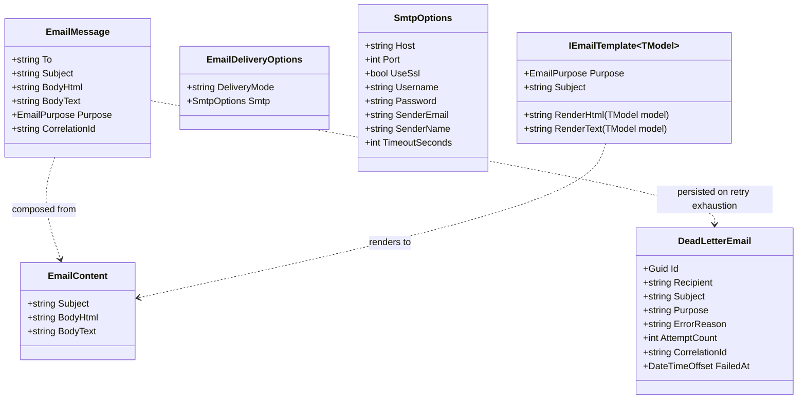
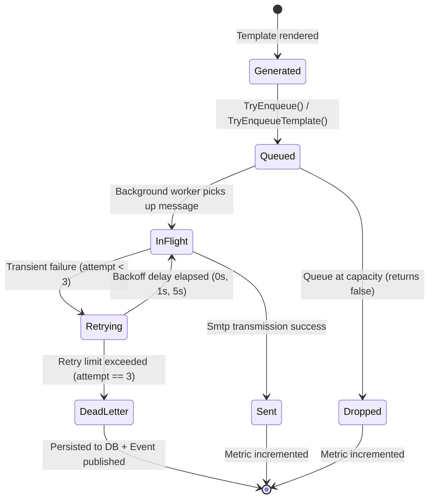

# Data Model: Real Email Delivery & Service Templating

**Feature**: `003-email-service-templating` | **Date**: 2026-11-13

## Entity Relationship Overview



---

## Entities & Value Objects

### 1. `EmailMessage` (Domain Record)

Represents an immutable transactional email message payload held in memory within `IEmailQueue`.

| Property | Type | Nullable | Validation Rules | Description |
|---|---|:---:|---|---|
| `To` | `string` | No | Valid email syntax, max length 256 | Destination recipient mailbox address |
| `Subject` | `string` | No | Not empty, max length 500, single line | Email subject line |
| `BodyHtml` | `string` | No | Not empty | Formatted HTML content with encoded user inputs |
| `BodyText` | `string` | No | Not empty | Plain-text fallback representation |
| `Purpose` | `EmailPurpose` | No | Defined enum value | Business category (`RegistrationOtp`, `PasswordReset`, `AccountNotice`) |
| `CorrelationId` | `string` | Yes | Max length 128 | Distributed tracing / operation identifier |

---

### 2. `DeadLetterEmail` (Domain Entity & Database Table)

Represents a durable record of an email delivery task that permanently exhausted all retries.

- **Table Name**: `dead_letter_emails`
- **Schema Mapping**:

| Column | PostgreSQL Type | Nullable | Default | Description |
|---|---|:---:|---|---|
| `id` | `uuid` | No | `gen_random_uuid()` | Primary key |
| `recipient` | `citext` | No | - | Recipient email address |
| `subject` | `varchar(500)` | No | - | Subject line of the failed message |
| `purpose` | `varchar(50)` | No | - | Purpose name (`registration_otp`, `password_reset`, `account_notice`) |
| `error_reason` | `text` | No | - | Sanitized diagnostic error classification and message |
| `attempt_count` | `integer` | No | `0` | Number of attempts made before abandonment |
| `correlation_id` | `varchar(128)` | Yes | `NULL` | Tracing correlation ID |
| `failed_at` | `timestamptz` | No | `now()` | Timestamp of the final failure |

- **Indexes**:
  - `pk_dead_letter_emails`: `PRIMARY KEY (id)`
  - `ix_dead_letter_emails_failed_at`: `INDEX (failed_at DESC)`
  - `ix_dead_letter_emails_recipient`: `INDEX (recipient)`

---

### 3. `EmailDeliveryOptions` & `SmtpOptions` (Configuration Entities)

Configuration settings mapped from `appsettings.json` section `Email`.

```csharp
public sealed class EmailOptions
{
    public const string SectionName = "Email";
    public string DeliveryMode { get; set; } = "Console"; // Smtp, Console, Disabled
    public SmtpOptions Smtp { get; set; } = new();
}

public sealed class SmtpOptions
{
    public string Host { get; set; } = "localhost";
    public int Port { get; set; } = 587;
    public bool UseSsl { get; set; } = true;
    public string? Username { get; set; }
    public string? Password { get; set; }
    public string SenderEmail { get; set; } = "no-reply@csraiders.com";
    public string SenderName { get; set; } = "CS Raiders";
    public int TimeoutSeconds { get; set; } = 15;
}
```

---

### 4. Template Parameter Models

Strongly-typed models passed into template definitions:

```csharp
public sealed record RegistrationOtpTemplateModel(
    string Otp,
    string DisplayName,
    int ExpiryMinutes = 15);

public sealed record PasswordResetTemplateModel(
    string ResetUrl,
    string DisplayName,
    int ExpiryMinutes = 60);

public sealed record SecurityNoticeTemplateModel(
    string Title,
    string Message,
    string DisplayName,
    DateTimeOffset Timestamp);
```

---

## State Transitions

### Email Message Lifecycle


