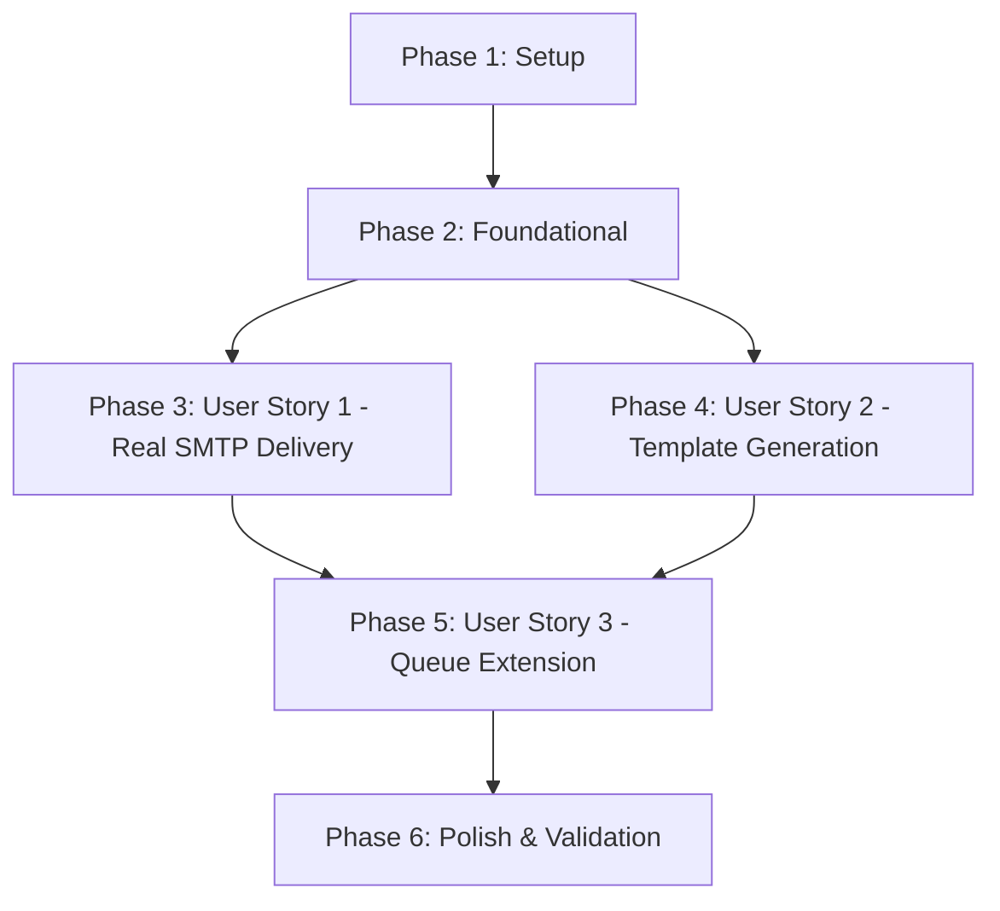

# Tasks: Real Email Delivery and Service Templating

**Input**: Design documents from `/specs/003-email-service-templating/`
**Prerequisites**: [plan.md](plan.md) ✅, [spec.md](spec.md) ✅, [research.md](research.md) ✅, [data-model.md](data-model.md) ✅, [contracts/email-contracts.md](contracts/email-contracts.md) ✅, [quickstart.md](quickstart.md) ✅

**Tests**: Included — unit tests for template rendering, HTML sanitization, non-blocking queue backpressure, and integration tests for SMTP delivery and dead-letter persistence per [quickstart.md](quickstart.md).

**Organization**: Tasks are grouped by phase and user story (US1, US2, US3) to enable independent implementation and verification.

## Format: `- [ ] [TaskID] [P?] [Story?] Description with file path`

- **[P]**: Parallelizable (different files, no blocking dependencies on preceding incomplete tasks).
- **[Story]**: User story identifier (`[US1]`, `[US2]`, `[US3]`) for story-specific phases.

---

## Phase 1: Setup (Shared Infrastructure)

**Purpose**: Package installation, configuration options, and entity enhancements required across all user stories.

- [X] T001 Add `MailKit` package reference (version 4.x) to `src/CsRaiders.Api.Infrastructure/CsRaiders.Api.Infrastructure.csproj`
- [X] T002 [P] Create `EmailOptions` and `SmtpOptions` configuration records in `src/CsRaiders.Api.Infrastructure/Options/EmailOptions.cs` and add default `Email` configuration section to `src/CsRaiders.Api.API/appsettings.json`
- [X] T003 [P] Update `EmailMessage` record in `src/CsRaiders.Api.Domain/Entities/EmailMessage.cs` to add `BodyHtml` and `BodyText` parameters while preserving backward-compatible `Body` accessor (`public string Body => BodyHtml;`)

**Checkpoint**: Solution compiles with MailKit and enhanced `EmailMessage` record.

---

## Phase 2: Foundational (Blocking Prerequisites)

**Purpose**: Dead-letter domain entity, database migration, repository persistence, and notification events. **MUST complete before user stories.**

**⚠️ CRITICAL**: No user story work can begin until this phase is complete.

- [X] T004 Create `DeadLetterEmail` entity (Guid Id, string Recipient citext, string Subject varchar(500), string Purpose varchar(50), string ErrorReason text, int AttemptCount, string? CorrelationId varchar(128), DateTimeOffset FailedAt) in `src/CsRaiders.Api.Domain/Entities/DeadLetterEmail.cs` per data-model.md
- [X] T005 [P] Create EF Core entity configuration `DeadLetterEmailConfiguration` in `src/CsRaiders.Api.Infrastructure/Persistence/Configurations/DeadLetterEmailConfiguration.cs` and add `DbSet<DeadLetterEmail> DeadLetterEmails` to `src/CsRaiders.Api.Infrastructure/Persistence/AppDbContext.cs`
- [X] T006 Generate EF Core database migration `Email_DeadLetterStore` in `src/CsRaiders.Api.Infrastructure/` and verify generated SQL table constraints and indexes (`pk_dead_letter_emails`, `ix_dead_letter_emails_failed_at`, `ix_dead_letter_emails_recipient`)
- [X] T007 [P] Create `IDeadLetterEmailRepository` in `src/CsRaiders.Api.Application/Common/Interfaces/Repositories/IDeadLetterEmailRepository.cs` and implement `DeadLetterEmailRepository` in `src/CsRaiders.Api.Infrastructure/Persistence/Repositories/DeadLetterEmailRepository.cs`
- [X] T008 [P] Create MediatR notification event record `EmailDeliveryFailedNotification` in `src/CsRaiders.Api.Application/Common/Events/EmailDeliveryFailedNotification.cs`

**Checkpoint**: Foundation ready — database migration compiles, entity and repository contracts available.

---

## Phase 3: User Story 1 - Real Email Delivery to Recipients (Priority: P1) 🎯 MVP

**Goal**: Deliver outgoing emails to external mailboxes over secure SMTP (TLS/STARTTLS) using MailKit, support offline development modes, isolate transient failures with retries, and persist exhausted messages to the dead-letter store.

**Independent Test**: Enqueue an `EmailMessage` and verify dispatch via `SmtpEmailSender` over TLS, or simulate failure to verify retry backoff and dead-letter persistence.

### Tests for User Story 1

- [X] T009 [P] [US1] Create unit tests for recipient masking and SMTP message building in `tests/CsRaiders.Api.Application.UnitTests/Security/SmtpEmailSenderTests.cs`
- [X] T010 [P] [US1] Create unit tests for `EmailSenderWorker` retry backoff (delays: 0s, 1s, 5s) and dead-letter store invocation in `tests/CsRaiders.Api.Application.UnitTests/Security/EmailSenderWorkerTests.cs`

### Implementation for User Story 1

- [X] T011 [US1] Implement `SmtpEmailSender` in `src/CsRaiders.Api.Infrastructure/Services/SmtpEmailSender.cs` implementing `IEmailSender` using MailKit `SmtpClient` with TLS encryption, authentication, timeout configuration, and MIME multipart/alternative generation
- [X] T012 [US1] Update `EmailSenderWorker` in `src/CsRaiders.Api.Infrastructure/Services/EmailSenderWorker.cs` to resolve `IServiceScopeFactory`, persist permanently failed emails to `IDeadLetterEmailRepository`, publish `EmailDeliveryFailedNotification` via `IPublisher`, and increment `email_queue.dead_letter` metric
- [X] T013 [US1] Wire DI registrations in `src/CsRaiders.Api.Infrastructure/DependencyInjection/InfrastructureServiceExtensions.cs` to bind `EmailOptions`, register `IDeadLetterEmailRepository`, and register `SmtpEmailSender` vs `ConsoleEmailSender` based on `Email:DeliveryMode`
- [X] T014 [US1] Create integration test verifying end-to-end SMTP dispatch and dead-letter failure handling in `tests/CsRaiders.Api.IntegrationTests/EmailDeliveryIntegrationTests.cs`

**Checkpoint**: At this point, User Story 1 is fully functional and delivers an MVP real email transmission capability with durable failure recovery.

---

## Phase 4: User Story 2 - Standardized Email Template Generation (Priority: P1)

**Goal**: Provide a clean, extensible template generation engine (`IEmailTemplateService`) that validates parameters, escapes dynamic inputs against HTML injection, and produces responsive rich HTML and plain-text fallback content.

**Independent Test**: Render each built-in template with valid models and verify that subject, HTML body, and plain-text output match specifications with dynamic values encoded.

### Tests for User Story 2

- [X] T015 [P] [US2] Create unit tests for template parameter validation and dynamic input HTML escaping (`<script>`, `&`, `"`) in `tests/CsRaiders.Api.Application.UnitTests/EmailTemplates/EmailTemplateSanitizationTests.cs`
- [X] T016 [P] [US2] Create unit tests for built-in template rendering (Registration OTP, Password Reset, Security Notice) in `tests/CsRaiders.Api.Application.UnitTests/EmailTemplates/EmailTemplateRenderingTests.cs`

### Implementation for User Story 2

- [X] T017 [P] [US2] Create `IEmailTemplate<in TModel>`, `IEmailTemplateService`, and `EmailContent` interfaces in `src/CsRaiders.Api.Application/Common/Interfaces/Security/IEmailTemplateService.cs`
- [X] T018 [P] [US2] Create template parameter models (`RegistrationOtpTemplateModel`, `PasswordResetTemplateModel`, `SecurityNoticeTemplateModel`) in `src/CsRaiders.Api.Application/Common/EmailTemplates/Models/`
- [X] T019 [P] [US2] Create responsive HTML layout builder `HtmlEmailLayout` in `src/CsRaiders.Api.Application/Common/EmailTemplates/Layouts/HtmlEmailLayout.cs` with brand styling and automatic `WebUtility.HtmlEncode` parameter replacement
- [X] T020 [US2] Implement built-in templates (`RegistrationOtpTemplate`, `PasswordResetTemplate`, `SecurityNoticeTemplate`) in `src/CsRaiders.Api.Application/Common/EmailTemplates/Templates/` implementing `IEmailTemplate<TModel>`
- [X] T021 [US2] Implement `EmailTemplateService` in `src/CsRaiders.Api.Infrastructure/Services/EmailTemplateService.cs` (or Application layer) and register in DI via `src/CsRaiders.Api.Infrastructure/DependencyInjection/InfrastructureServiceExtensions.cs`

**Checkpoint**: User Stories 1 AND 2 are complete — real emails can be generated from strongly-typed templates and sent over SMTP.

---

## Phase 5: User Story 3 - Direct Templated Email Queueing via Extension (Priority: P2)

**Goal**: Provide a fluent queue extension and `ITemplatedEmailQueue` facade allowing consuming services to render and enqueue templated emails in a single atomic call with non-blocking backpressure semantics.

**Independent Test**: Invoke `emailQueue.TryEnqueueTemplate(...)` and confirm that a rendered `EmailMessage` arrives in `IEmailQueue`, returning `false` immediately when saturated.

### Tests for User Story 3

- [X] T022 [P] [US3] Create unit tests for `TemplatedEmailQueueExtensions` and `ITemplatedEmailQueue` verifying atomic rendering, queueing, and non-blocking `false` return on queue saturation in `tests/CsRaiders.Api.Application.UnitTests/Security/TemplatedEmailQueueTests.cs`

### Implementation for User Story 3

- [X] T023 [P] [US3] Create `ITemplatedEmailQueue` interface and `TemplatedEmailQueueExtensions` static class in `src/CsRaiders.Api.Application/Common/Interfaces/Security/ITemplatedEmailQueue.cs`
- [X] T024 [US3] Implement `TemplatedEmailQueue` facade in `src/CsRaiders.Api.Infrastructure/Services/TemplatedEmailQueue.cs` implementing `ITemplatedEmailQueue` and register as scoped/singleton in DI
- [X] T025 [US3] Refactor `RegisterCommandHandler` in `src/CsRaiders.Api.Application/Features/Auth/Commands/Register/RegisterCommand.cs` to queue via `RegistrationOtpTemplate` using `TryEnqueueTemplate`
- [X] T026 [US3] Refactor `ResendOtpCommandHandler` in `src/CsRaiders.Api.Application/Features/Auth/Commands/ResendOtp/ResendOtpCommand.cs` to queue via `RegistrationOtpTemplate` using `TryEnqueueTemplate`
- [X] T027 [US3] Refactor `ForgotPasswordCommandHandler` in `src/CsRaiders.Api.Application/Features/Auth/Commands/ForgotPassword/ForgotPasswordCommand.cs` to queue via `PasswordResetTemplate` using `TryEnqueueTemplate`

**Checkpoint**: All three user stories functional — consuming command handlers directly use the templated queue extension with clean separation of concerns.

---

## Phase 6: Polish & Cross-Cutting Concerns

**Purpose**: End-to-end verification, architecture validation, documentation updates, and regression testing.

- [X] T028 [P] Update documentation in `src/CsRaiders.Api.Infrastructure/Services/README.md` and `docs/designs/` describing the new email delivery, templating, and dead-letter architecture
- [X] T029 Add architecture tests in `tests/CsRaiders.Api.ArchitectureTests/EmailArchitectureTests.cs` verifying that Domain and Application layers have no dependency on `MailKit`
- [X] T030 Execute full validation scenarios described in `specs/003-email-service-templating/quickstart.md`
- [X] T031 Run entire test suite (`dotnet test`) across all projects to ensure zero regressions in existing authentication and session tests

---

## Dependencies & Execution Order

### Phase Dependencies

- **Setup (Phase 1)**: Can start immediately.
- **Foundational (Phase 2)**: Depends on Phase 1; BLOCKS User Stories.
- **User Story 1 (P1)**: Depends on Foundational completion; establishes real delivery transport.
- **User Story 2 (P1)**: Depends on Foundational completion; can proceed in parallel with US1.
- **User Story 3 (P2)**: Combines User Story 1 (Queue/Worker) and User Story 2 (Template Service) to provide fluent ergonomics to calling handlers.
- **Polish (Phase 6)**: Runs after all user stories are complete.

### Parallel Opportunities

- **Phase 1**: T002 and T003 can execute in parallel.
- **Phase 2**: T005, T007, and T008 can execute in parallel once entities exist.
- **Phase 3**: Tests T009 and T010 can be written in parallel.
- **Phase 4**: Template models T018, layout T019, and interfaces T017 can be written in parallel.
- **Phase 5**: Consumer refactoring T025, T026, and T027 can execute in parallel.

---

## Implementation Strategy

### MVP First (User Story 1 Only)

1. Complete Phase 1 (Setup) and Phase 2 (Foundational).
2. Complete Phase 3 (User Story 1: MailKit SMTP delivery, retry backoff, dead-letter store).
3. **STOP and VALIDATE**: Verify email delivery and failure handling independently via `quickstart.md` Scenario 3 & 4.
4. Deliver MVP working email transport.

### Incremental Delivery

1. Phase 1 + Phase 2 → Database migration and infrastructure foundations ready.
2. Phase 3 (US1) → Real SMTP delivery functional (MVP).
3. Phase 4 (US2) → Templating service ready with sanitized HTML/text generation.
4. Phase 5 (US3) → Command handlers updated to use templated queue extension directly.
5. Phase 6 → Full test suite and architectural compliance confirmed.
